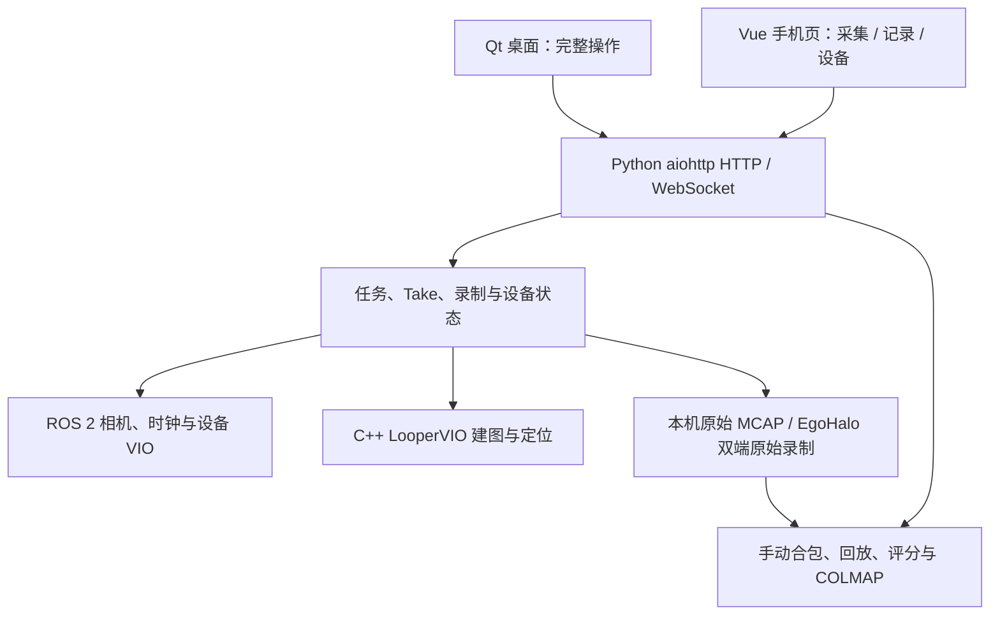

# 项目结构

当前项目的主干是 **一套 Python 后端、Qt 桌面与手机网页两个入口、两套设备配置**。设备差异由配置选择，不需要为每套硬件维护一个软件分支。

Qt 和手机使用相同任务、录制状态与后端算法。Qt 使用 C++/QML、Qt Quick 3D、GStreamer；手机使用 Vue 和 esbuild。运行、发布由 Docker、宿主机服务和 `deploy/` 脚本配合完成。

## 统一维护与交付规则

1. **日常开发和两套硬件交付统一使用 `main`。** 两个历史分支用于追溯或比对；`hz-capture-v1-aruco` 尚有独有提交，不作为主线的配置开关，也不直接删除。
2. **设备型号只通过下面两套 profile 选择。** Insight9 头部选择 `jetson-nx`；EgoHalo 头部选择 `jetson-nx-egohalo`。Qt/手机入口、录制模式和标定文件不另起“项目版本”。
3. **每次交付应同时记载版本号、完整源码提交号、设备 profile 和发布包 SHA-256。** 源码有未提交修改时另外标明 dirty；仅凭 `pyproject.toml`、手册标题或镜像标签不能确认安装内容。当前构建脚本接受调用者提供的版本号，未自动记录本项目源码提交号，这条追溯规则尚需在交付流程中落实。
4. **现场状态必须单独核对。** `.device`、当前两个生成配置与运行服务应一致；缺少 `runtime.json` 或文件与模板有差异时记为“待核对”，先识别现场自定义参数再迁移。盘点不能自动覆盖配置、切换 profile 或重启设备。

截至本次盘点，源码基线为 `2.1.0 / 011a065`，其后的删除修复由 Git 提交记录追溯；本机配置状态为“待核对”：`.device` 是 `jetson-nx`，但 `cameras.json` 不匹配任一当前模板，`runtime.json` 缺失。此结论只描述本地目录，不代表现场设备实际安装版本。

## 审查覆盖与验收边界

当前进行了有明确范围的审查和回归验证，**没有完成全仓逐行审查**。读取指南目录、运行全套测试、构建成功都不能替代源码审查或真机验收。

| 代码范围 | 已做工作 | 仍未覆盖 |
| --- | --- | --- |
| Python API、任务与录制 | 删除/合包、并发锁、失败重试、恢复与相邻回放路径审查和合成回归 | 其余 API、运行时和后处理代码的完整逐行审查 |
| 手机 Vue、JS、CSS | 删除确认、校时、预览生命周期与共享交互审查，废弃样式清理 | 全部组件状态的真实浏览器、辅助技术和性能验收 |
| 配置与部署 | 两套 profile、配置生成、启动与升级保护入口核对 | 完整安装/升级链路及实际设备配置验收 |
| Qt/QML、原生 C++ 建图 | 核对模块职责和调用边界 | 完整实现、算法、内存与线程安全审查，以及构建/真机验收 |
| 第三方与历史代码 | 核对当前依赖/分支入口 | 第三方源码与全部 Git 历史审计 |

## 配置如何区分

| 设备配置名 | 组合 | 录制路径 |
| --- | --- | --- |
| `jetson-nx` | Insight9 头部 + 左右两台 Insight3 | Jetson 本机录制 |
| `jetson-nx-egohalo` | EgoHalo 头部 + 左右两台 Insight3 | Jetson 保存腕部，EgoHalo 保存头部原件；采集结束后手动回传合包 |

Git 跟踪的 `config/` 共 **6 个文件**：每套设备各有 `cameras.json` 和 `runtime.json`，另外共用 `capture_tasks.json` 与 `rosbag_qos_overrides.yaml`。目前两套 `runtime.json` 内容相同，硬件与双端录制差异主要在各自 `cameras.json`。

`scripts/select_device.sh <配置名>` 把选中模板复制到本机 `config/cameras.json`、`config/runtime.json`，并写入 `config/.device`。这些生成文件被 Git 忽略；`.device` 只记录上次选择，不能证明文件仍与模板一致。正常切换会重载服务；`--no-start` 仍会覆盖配置文件，只是不操作 Docker。

现场标定、在线对齐状态、`.env`、录制数据与处理产物属于实例状态，不算额外的设备配置。旧 `config/post_processing.json` 也不构成第三套配置；当前运行配置入口是 `config/runtime.json`。选择模板时要保留或迁移现场自定义参数，不能把重新选择配置当作无副作用的检查。

另外几种名称也不应混算：`capture` 与 `vio_calibration` 是普通采集和 VIO 标定两种录制模式；Compose 的 `egohalo` 是按硬件启用的服务组；任务目录里的 `capture_profile` 是任务元数据（内置任务为 `cup_stacking`，标签为 `dual_arm_umi`），不代表又一套设备配置，也不代表已删除的 UMI 导出功能仍存在。

## 分支、标签与运行版本

截至 **2026-11-18**，以主线提交 `011a065` 为基准，远端实际有 **3 个分支**：

| 分支 | 与主线的关系 | 如何理解 |
| --- | --- | --- |
| `main` | 当前主线 `011a065` | 日常开发与设备配置共同使用 |
| `codex/stream-startup-recovery` | 分支顶点已包含在 main；main 多 107 个提交 | 历史开发分支，不是另一套运行配置 |
| `hz-capture-v1-aruco` | main 独有 203 个提交，分支独有 42 个提交 | 已分叉的独立历史，不能当作已合并分支删除 |

本机只有 `main` 一个本地分支；另外有一个 detached worktree，停在相同提交。`origin/HEAD` 是默认分支指针，不是第四个分支。以上数字是盘点快照，后续应重新用 Git 核对。

本次盘点本地共有 **9 个标签**：`v2.0.0` 至 `v2.0.6` 七个版本标签，以及 `native-qt-stable-2026-10-10`、`v0.2-single-camera-trail-image`。`pyproject.toml` 当前源码版本为 **2.1.0**；本地标签列表没有 `v2.1.0`。标签、发布包、设备实际安装版本各自独立，不能由源码版本推断设备已升级。

## 目录职责

- `native_dashboard/`：Qt 七个入口，原生图像、空间轨迹、任务、录制库、评分、COLMAP、录制与设置。
- `web_dashboard/`：轻量手机采集页，保留任务、校准、按需预览与手动合包。
- `insight_capture/api/`：两端共用的 HTTP/WebSocket。
- `insight_capture/runtime/`：ROS 输入、LooperVIO 接入、时钟、任务、录制、双端合包与中断恢复。
- `insight_capture/media/`：图像解码、Jetson 编解码、Qt 直通及手机 WebRTC。
- `insight_capture/postprocess/`：录制库、手动同步回放、完整性/轨迹评分与离线 COLMAP。
- `insight_capture/core/bag.py`：每条录制一个标准 MCAP，内部多 Chunk；不读取旧组合包、SQLite 或多文件分包。
- `native_mapping/`：唯一在线 C++ 建图/定位核心；其测试和 SuperGlue 推理构建工具保留。
- `config/devices/`：仅 Insight9 与 EgoHalo 两套配置。
- `tools/diagnostics/`：启动同步支持与回放诊断工具；通用设备维护 CLI 和系统医生已删除。
- `tools/mapping_validation/`：在线推理构建工具，不含稠密地图或 RViz 服务。
- `deploy/`：镜像、Qt 产物交付、配置联动和升级。

WiLoR、系统医生、设备维护 CLI、旧单相机板评估、稠密双目遗留与 Torch 对照后端，以及 UMI Zarr/LeRobot 导出、夹爪开合追踪、设备手部骨架叠加、固定检测位、Lite 配置、OpenClaw 和假位姿模式已删除。腕部定位遮罩默认关闭；COLMAP 与原始录制保留。回放无后台预生成或排队；用户手动选择录制并准备。
