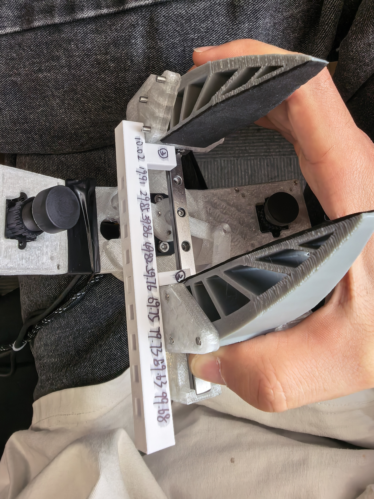

# x86 ArUco 数采工作台

独立入口：`python3 -m insight_capture.aruco_capture.app`。不启动原 Dashboard、SuperPoint/SuperGlue、建图器或夹爪 VIO。算法不要求 CUDA/GPU，4090 无需参与首版定位。

## 启动

在 Ubuntu x86 主机安装 Docker 和 Compose：
```bash
# 安装 Docker
curl -fsSL https://get.docker.com | sudo sh

# 设置 Docker 开机启动
sudo systemctl enable --now docker

# 当前用户加入 docker 组
sudo usermod -aG docker $USER

# 安装 Docker Compose v2
sudo apt update
sudo apt install -y docker-compose-v2

# 查看版本
docker --version
docker compose version
```

然后在本分支根目录执行：

```bash
# 首次构建
docker compose -f deploy/aruco/compose.yml build --build-arg PIP_INDEX_URL=https://mirrors.aliyun.com/pypi/simple/
docker compose -f deploy/aruco/compose.yml up -d

# 重新构建
docker compose -f deploy/aruco/compose.yml up --build -d
```

浏览器访问 `http://localhost:8770`；其他电脑访问部署主机的局域网地址、端口 `8770`。

```bash
docker compose -f deploy/aruco/compose.yml logs --tail=100
docker compose -f deploy/aruco/compose.yml down
```

没有 Compose/Buildx 插件时，也可直接运行：

```bash
DOCKER_BUILDKIT=0 docker build --network host -f deploy/aruco/Dockerfile -t insight-aruco-capture:local .
mkdir -p outputs/aruco-capture outputs/lerobot_datasets
docker run -d --name insight-aruco-capture --network host --init \
  --restart unless-stopped --stop-signal SIGINT \
  -e RMW_IMPLEMENTATION=rmw_fastrtps_cpp \
  -e ARUCO_DEVICE_ROOT=/host-dev \
  --device-cgroup-rule='c 81:* rw' \
  --device-cgroup-rule='c 188:* rw' \
  --device-cgroup-rule='c 166:* rw' \
  -v /dev:/host-dev:ro \
  -v "$PWD/config/devices/x86-aruco/capture.json:/app/config/devices/x86-aruco/capture.json" \
  -v "$PWD/outputs:/app/outputs" \
  insight-aruco-capture:local
```

下载较慢时可在构建命令中添加 `--build-arg PIP_INDEX_URL=https://mirrors.aliyun.com/pypi/simple/`，仅影响镜像构建，不修改主机全局 pip 配置。

停止用 `docker stop insight-aruco-capture`，再次启动用 `docker start insight-aruco-capture`，日志用 `docker logs --tail=100 insight-aruco-capture`。代码修改后重新构建镜像并重建容器，录制数据保留在宿主机目录；配置修改只需停录后重启容器。

这是独立服务和端口，不需要切换原 Dashboard 的 live profile。已有 Python/ROS 环境也可以直接运行：

```bash
source /opt/ros/humble/setup.bash
python3 -m insight_capture.aruco_capture.app --config config/devices/x86-aruco/capture.json
```

依赖见 `deploy/aruco/Dockerfile`。镜像使用 ROS Humble/Ubuntu 22.04 的多架构基础镜像，不包含 Jetson、TensorRT、模型权重或浏览器。相机发现使用 host 网络；设备须与主机网络互通，`ros_domain_id` 须与 Insight9 一致。

使用方式参考如下视频：

<video src="./source/二指UMI数采指南.mp4" controls width="360"></video>

（GitHub 网页预览支持直接播放内嵌视频；若在不支持 `<video>` 标签的 Markdown 查看器里看不到播放器，可点击 [二指UMI数采指南.mp4](./source/二指UMI数采指南.mp4) 下载后用本地播放器打开。）

## 配置输入

唯一入口为 `config/devices/x86-aruco/capture.json`：

- `ros_domain_id`：须与 Insight9 实际广播使用的 ROS domain 一致，不能照抄模板默认值——不同设备/网络需要用 `ros2 topic list`（配合 `ROS_DOMAIN_ID=<N>` 逐个试）实测确认。
- `head`：Insight9 已校正 RGB、CameraInfo、原始 VIO 话题（`image_topic`/`info_topic`/`vio_topic`），以及 IMU/RGB TF frame。三个话题各自独立订阅——只有确认对应话题真的存在发布者时才会绑定，不会对着空话题空等；没有内参、外参或新鲜 VIO 时不能起录。头部相机物理安装方向是横的，`capture.py` 会把每一帧顺时针旋转 90° 后再写入实时预览、录制的 `capture.sqlite3` 和最终导出的视频；这个旋转不是配置项，只影响人眼看到/导出的画面字节，ArUco 位姿检测继续用旋转前的原始帧和未变的相机内参，互不影响。
- `arms`、`tcp`、`cube_marker_relative_localization.targets`：左右手标记编号、几何及既有硬件外参，`camera` 字段用 `gripper_left`/`gripper_right` 命名（对应主 Dashboard 里的 `insight3_b`/`insight3_a`）。沿用当前硬件，无须夹爪相机上报 VIO；cube 标记具体布局和坐标系见 [Cube Marker 布局](#cube-marker-布局)。
- `rgb`：附加相机列表，当前实际部署为 4 路 UVC（左右手各上/下两路），**每次更换主机都需要使用 `ls -l /dev/v4l/by-path` 命令确认相机输出的路径**。除 `name`/`device`/`width`/`height`/`fps` 外，还支持：
  - `auto_exposure: false`：关闭自动曝光（不写这个字段则维持相机驱动默认的自动曝光）
  - `exposure_time_absolute`：配合 `auto_exposure: false` 固定曝光时间，取值范围因相机而异，用 `v4l2-ctl -d <device> --list-ctrls-menus` 查具体相机支持的区间；不填则冻结在切换到手动模式那一刻的自动曝光值上，不会再变
  无对应设备时显示缺失并降低有效率。
- `serial`：编码器输入列表，`hands` 字段取 `"left"`/`"right"`（一个串口只对应一只手的单通道编码器）或 `"both"`（同一个串口输出双手数据）。
- `fps`：导出与 QC 的统一采样率，同时也是实时页视频预览与状态轮询的节奏（页面右上角可直接改，改完立即生效；仅影响下次开始录制起的导出网格，不影响已录数据）。原始输入按实际收到的数据保存。

USB RGB 示例，替换 `rgb` 中对应项：

```json
{"name":"rgb_left_up","device":"/dev/v4l/by-path/pci-0000:00:14.0-usb-0:4:1.0-video-index0",
 "width":1280,"height":720,"fps":30,"auto_exposure":false,"exposure_time_absolute":156}
```

原始 ROS Image 示例：

```json
{"name":"rgb_left","topic":"/rgb_left/image_raw","compressed":false}
```

编码器实际使用的是 MT6701 磁编码器固件的单通道协议，每行 JSON：

```json
{"raw":1234,"angle_degree":12.34,"opening_mm":56.78}
```

固件还会输出 `{"info":"..."}`/`{"error":"..."}` 状态行（工作台会解析并显示，不当作开合度数据）。对应配置：

```json
{"device":"/dev/serial/by-id/usb-Espressif_USB_JTAG_serial_debug_unit_XXXX-if00",
 "baudrate":115200,"hands":"left",
 "left":{"scale_m":1,"offset_m":0,"max_width_m":0.10}}
```

`scale_m`/`offset_m` 是在固件已经算出的 `opening_mm`（毫米）基础上再做一次线性修正，默认 `scale_m:1,offset_m:0` 即直接信任固件读数（只做 mm→m 单位换算）。旧的"一行 JSON 同时输出双手"协议（`{"left":1234,"right":5678}`）仍兼容，`hands` 设为 `"both"` 即可。Compose 已挂载动态设备目录并允许 V4L2、USB 串口和 ACM 串口节点；无需事先写死设备编号。硬件协议如有变化只修改 `sources.py` 的 `serial_worker` 读取函数。

## 热插拔与扫描端口

实时采集页展开“设备连接与端口”，点击“扫描设备”，为各路 RGB 选择 USB 视频端口，或保留原 ROS 话题；编码器可选一个双手串口，或两个分别对应左右手的串口，并填写波特率。点击“应用设备选择”后立即重连，无需重启服务。录制期间允许扫描，停止录制后才能换绑。

- USB 相机和串口在启动时可以缺席；断线、读取失败或持续 4 秒无数据后关闭旧连接，每秒重试一次。USB 读取使用可终止的 FFmpeg 子进程，避免驱动阻塞拖住工作台。
- 成功收到图像或有效编码器数据后，自动清除对应设备的故障；其他设备故障和 VIO 重置等录制错误保留。原始采集缺失时间仍进入 QC，重连不会补造数据。
- 扫描只枚举视频采集节点，过滤元数据节点。优先绑定 `/dev/v4l/by-id/`、`/dev/serial/by-id/` 的设备标识；没有设备标识时使用 `by-path` 的 USB 插口标识。编号改变后会重新解析链接；既没有稳定标识又更换了编号时，请重新扫描选择，不能自动猜测左右设备。
  - **已知坑**：同型号 UVC 相机（本机用的 DECXIN）经常上报**完全相同**的 `by-id` 厂商字符串，多台同型号相机接上后 `/dev/v4l/by-id/` 只解析得出一组符号链接，没法用它区分具体是哪一台——这种情况必须改用 `by-path`（USB 物理插口）绑定，重插到别的口才需要重新扫描，不能指望 by-id 兜底。
- 页面选择保存到 `outputs/aruco-capture/_devices.json`，下次启动自动加载。要调整串口数值到米的标定，可修改该文件对应 `left`/`right` 标定字段后重启，或清除覆盖文件后使用模板配置。
- 应用设备选择成功后，RGB/串口绑定还会**顺带同步写回** `config/devices/x86-aruco/capture.json`（Compose 把它挂载为宿主机可写，不再是 `:ro`），这样换了主机、换了 USB 口重新扫描绑定一次之后，模板文件本身就是最新的 by-path/by-id，不用再手动编辑 JSON；这一步是尽力而为，写失败（比如还没用新版 compose 重建、挂载仍是只读）只会在容器日志里打一行提示，不影响本次设备切换本身。
- 每路 RGB 的采集帧率（`fps`）现在也能在设备面板里直接改，和选设备端口用的是同一个"应用设备选择"流程——提交后会重启对应的 ffmpeg 采集子进程，带上新的 `-framerate`。
- UVC 采集需要 ffmpeg 显式指定 `-input_format mjpeg`（`usb_worker` 已加），否则可能协商到相机的 YUYV 模式——同分辨率下 YUYV 常明显慢于 MJPG（比如 720p 下 YUYV 只有 10fps，MJPG 能到 60fps）。某路 RGB 实测帧率明显低于配置的 `fps` 时，先用 `v4l2-ctl -d <device> --list-formats-ext` 确认该分辨率下两种格式各自的帧率上限，不要只怀疑软件层。
- Insight9 图像、CameraInfo、TF 和 VIO 继续使用原 ROS 配置；扫描 USB 相机不会替代 Insight9 的 ROS/VIO 驱动。VIO 接收中断超过 2 秒后恢复，会更换轨迹参考系代次；正在录制的后续位姿无效，需要停止后新建录制，避免拼接未知坐标系。
- **Insight9 掉线自动重连**：ROS2 的中间件（`rmw_fastrtps_cpp`/`rmw_cyclonedds_cpp`，从 ROS2 Foxy 起）是"一个进程一个 DDS Participant"，不是"一个 Node 一个 Participant"——网络接口扫描只在进程启动那一刻做一次。如果 Insight9 的 USB 网卡（ROS Native 模式下表现为一张 `169.254.x.x` link-local 接口）是在容器**启动之后**才插上的，光等待或重新订阅是发现不了的，必须重建整个 rclpy 参与者才能重新扫描接口。工作台内置了一个后台看门狗（`sources.py` 的 `watch_head_interface`，每 1 秒检查一次）：一旦发现"Insight9 图像/VIO 数据不新鲜 且 出现了之前没见过的网络接口"，就自动重建一次 ROS 层——**只重建订阅 Insight9 的那部分**，UVC 相机和串口线程全程不受影响，不会跟着一起断线重连。日常仍建议先插好 Insight9 再启动容器；顺序反了也不需要手动重启，等 1-2 秒看门狗会自己处理。

Docker 使用 `/dev:/host-dev:ro` 和设备 cgroup 规则允许视频（81）、USB 串口（188）、ACM 串口（166）访问，以支持启动后新增设备；不需要静态 `--device` 节点。参见 [Docker 动态设备说明](https://docs.docker.com/engine/containers/run/#using-dynamically-created-devices)。

## 夹爪开合度标定

编码器固件（MT6701 磁编码器 + ESP32）自己维护一张"角度→开合度(mm)"的分段线性表，开机从 flash 加载，没有存过标定则用出厂默认值；实际开合度换算（`angleToOpening`）在固件里完成，工作台只是转发固件已经算好的 `opening_mm`。

**标定命令协议**（`sources.py` 的 `send_serial`，通过串口下行）：
- `start_cal`：进入标定模式，固件端标定点计数清零；进入后固件的遥测行会变成只有 `{"raw":...,"angle_degree":...}`（不含 `opening_mm`），工作台据此判断"当前处于标定模式"
- `{"opening_mm": <数值>}`：把"当前角度"和"这个手动测量的开合度"记为一个标定点；必须先 `start_cal`
- `end_cal`：按角度排序、检查重复角度，写 flash 并**立即生效**；至少需要 2 个点。失败（点数不够/角度重复）时固件**不退出标定模式**，也不会用半成品覆盖旧的标定表——旧标定继续有效，可以直接补点后再次 `end_cal`

对应的 HTTP 接口：`POST /api/serial/{index}/command`（body 为 `{"command":"start_cal"}` / `{"command":"opening_mm","value":91.5}` / `{"command":"end_cal"}`），`GET /api/serial/{index}/log?after=<seq>` 增量拉取固件的 `info`/`error` 反馈和实时角度。

**页面操作**（实时采集页"设备连接与端口"→对应编码器行下方的"夹爪标定"子面板）：
1. 点"开始标定"（同一个按钮，标定中会变成"退出标定并保存"）
2. 把夹爪开到一个已知宽度，用卡尺量出毫米数或使用标定尺测量（示例见下图），填进"开合度 (mm)"输入框（步长 10），点"记录点"；至少两个不同角度重复这一步

   
3. 点"退出标定并保存"提交；面板下方日志区会实时显示固件的角度遥测、每次记录确认（"第 N 点：角度 X° → 开合度 Ymm"）和最终"标定已保存，共 N 点"或具体报错
4. 发现某个点录错了：点"重新标定"（对应 `start_cal`，固件端标定点计数清零，工作台侧也清空当页已显示的记录列表），从头补录——固件没有单点覆盖/删除命令，录错了只能整段重录，不能只改一个点

录制中或设备面板忙碌时整个标定面板会跟着其他设备控件一起禁用。

## 采集与标注

1. 确认头部标定、图像和 VIO 就绪，检查左右 cube 位姿；顶部“录制名称”输入框可自定义本次录制的名称（默认 `My_Capture`，只能含字母、数字、下划线、短横线），开始录制后目录名为 `<名称>_<时间戳>`，同名同秒冲突会自动加序号后缀。
2. 停录后进入“回放与标注”。录制记录下拉列表按时间倒序排列，尚未标注的录制会带“· 未标注”后缀；列表右侧“刷新列表”按钮之后另有“上一项/下一项”按钮，可在已停止的录制之间快速切换。播放、暂停、逐帧、倍速和拖动时间轴都会同步各路视频、3D TCP 与开合度。按空格播放/暂停，左右方向键逐帧，I/O 设置片段起止点。
3. 设置片段起止时间、任务文本和参与手臂（左手、右手、双手），添加或编辑片段后保存全部标注。片段不允许重叠；切换录制或关闭页面前提示未保存修改。“动作片段”列表的“自动分段（静止检测）”按钮会按双臂线速度、角速度、开合速度是否同时低于阈值并持续 0.8 秒以上，生成一组任务文本为空的片段草稿（移植自 main 分支 `auto_pause` 的静止检测），仍需人工逐段填写任务文本后才能保存；点击后会覆盖当前未保存的片段列表，保存前可点击“撤销自动分段”撤回。
4. “质量与导出”显示各维度有效率、缺失时段、20 维详细统计以及可导出片段/帧数。点击缺失区间回到相应时刻检查；预估和最终导出共用有效区间计算。

工作台使用深色布局，左手蓝色、右手橙色。实时页显示输入接收频率、相机/VIO/内外参状态、cube 标记与重投影误差、TCP 坐标和串口开合度。无数据时明确显示等待或无效，不填充演示数值。

3D 轨迹使用仓库已有 Babylon.js，在本地提供资源，网页无需访问 CDN。支持旋转、平移、缩放、适配、俯视/正视/侧视和全屏；坐标单位米，网格间距 0.1 m，TCP 附带 XYZ 朝向轴。无效帧和超过 0.3 秒的间隔会断开轨迹。实时轨迹保留约 4 分钟、最多 2400 次观测，开始新录制或 VIO 重置时清空旧参考系轨迹；离线回放显示整次录制轨迹，长录制只抽稀绘制点，不改变原始数据和 QC。

视频预览为按需 JPEG，实时界面最高约 5 次更新/秒；回放拖动时间轴时，3D 轨迹光标和左右手 TCP/开合度会**立即**按拖动位置更新（`review.rows` 已整个加载在浏览器内存里，纯本地数组查找，不受视频影响）；视频画面仍按浏览器实际请求与解码速度显示，快速拖动时可能滞后于当前光标位置几帧，不能把网页视频显示速率当作输入帧率。采集和导出使用原始输入与配置采样率。

原始数据位于 `outputs/aruco-capture/<名称>_<时间戳>/`：

- `capture.sqlite3`：图像载荷、头部 VIO、左右 TCP 检测及串口原始数值。ROS 回调只排队，写盘和检测在一个独立线程。
- `session.json`：配置、标定、参考变换、时长及错误记录。
- `segments.json`：人工确认的时间范围、任务文本及 `hands` 参与手臂；旧标注默认 `both`。
- `quality.json`：全录制预期时间轴上的有效帧占比。

导出统一走“累加导出到统一数据集”（见下一节），不再单独导出到每次录制自己的子目录。

停录会排空已入队的数据并提交数据库。异常中断的会话保留原始 SQLite，首版不自动恢复或导出未正常结束的录制。

## 位姿与有效性

每次录制以**第一帧能够与头部 VIO 同步的 RGB 所对应的 IMU 位姿**建立固定参考系。双臂共用该参考系；不同录制的原点独立。

```text
T_reference_TCP = inverse(T_world_IMU_start)
                × T_world_IMU_at_image
                × T_IMU_RGB
                × T_RGB_cube
                × T_cube_camera_center
                × T_camera_center_TCP
```

头部 VIO 在图像源时间戳处插值，不外推；其累计漂移不会被 cube 定位消除。检测到头部时间回退或大幅 VIO 跳变后，本次录制后续位姿标为无效，须停止并重新录制。

**固定相机模式（不使用 VIO）**：实时采集页顶部"使用 VIO"开关默认启用；头部相机刚性固定、不会移动时可以关闭（录制中不可修改，停止后才能切换，下次开始录制起生效，设置写入 `_devices.json` 持久化）。关闭后：
- 开始录制不再要求 Insight9 发布 VIO 话题或 VIO 数据新鲜，只要求 RGB、CameraInfo 和 IMU→RGB 外参就绪。
- 位姿计算把 IMU 坐标系当作与世界坐标系重合（固定不变），上面公式里的 `T_world_IMU_start`/`T_world_IMU_at_image` 都退化成单位阵，cube 位姿完全相对这个固定相机计算，不再有 VIO 漂移或外推误差。
- 即使 VIO 话题实际仍有数据（只是没被使用），其跳变/重置也不会触发"VIO 重置，请停止后重新录制"——这个判断只在开关开启时生效。
- 热插拔看门狗（见下一节）判断"是否失联"时也会跳过 VIO 新鲜度，只看图像话题，避免固定相机场景下因为 VIO 永远不新鲜而误判。

单面标记允许定位：IPPE 候选先通过深度及重投影检查，误差接近时参考近期全局 cube 位姿选择，再检查运动跳变。没有时间先验的首帧和遮挡后重现仍有平面多解风险；不把低重投影误差当作精度证明。标记不可见不保持上一帧作为有效位姿。

左右手 TCP 卡片 `valid: false` 时附带的 `reason` 精确到具体在哪一步失败，不再笼统显示"未检测到"：

| 阶段 | `reason` | 前端文案 |
| --- | --- | --- |
| 一个 marker 都没看到 | `marker_not_detected` | 未检测到 cube |
| 看到了但不够数量要求 | `not_enough_markers_visible` | 可见标记数量不足 |
| `solvePnP`/`solvePnPRansac` 本身失败 | `pnp_solve_failed` | 位姿求解失败 |
| RANSAC 内点比例太低 | `low_inlier_ratio` | 内点比例过低 |
| 多面校正模式下有效面不够 | `insufficient_face_support` | 有效标记面不足，几何不稳定 |
| 点集几何退化（近似共面） | `degenerate_geometry` | 标记共面/退化，无法求解 |
| 解出来的深度超出合理范围 | `depth_out_of_range` | 推算深度超出合理范围 |
| 重投影误差超阈值 | `reprojection_too_high` | 重投影误差过大 |
| 与上一帧相比位姿跳变过大 | `pose_jump` | 位姿跳变，当前帧无效 |
| 头部 VIO 被重置（时间回退/大跳变） | `head_vio_reset` | VIO 重置，请重新录制 |
| 缺少同步 VIO 或内外参未就绪 | `missing_head_pose_or_calibration` | 缺少同步 VIO 或标定 |

前 8 个来自 `cube_markers.py`/`pose.py` 的 `_solve_target()`（`MultiCubeMarkerEstimator.last_reasons`，跟主 Dashboard 共用同一套检测代码，纯附加字段，不影响主 Dashboard 现有调用），后 3 个是 `pose.py` `observe()` 里已有的录制级判断。

`pose.py` 的 `DirectPose` 初始化时用 `dataclasses.replace(...)` 把 `apply_corrections` 强制设为 `False`、`min_markers` 强制设为 `1`，**不管 `capture.json` 的 `cube_marker_relative_localization.apply_corrections`/`min_markers`填的是什么都会被覆盖**——当前模板里这两个字段分别是 `true`/`1`，其中 `apply_corrections: true` 对这个独立工作台完全不生效（只有主 Dashboard 走的另一套代码路径会用到），不要指望改它能打开多面校正。真正生效、影响单标记 IPPE 候选筛选和多标记 RANSAC 的是 `min_inlier_ratio`（当前 `0.6`）、`max_reprojection_error_px`（当前 `2.5` px）、`min_depth_m`/`max_depth_m`（当前 `0.1`–`3.0` m），这几个阈值改了立即生效，不需要重新构建镜像。

RGB/串口跨设备同步首版使用**主机接收时间**最近邻，容差取 `sync_tolerance_ms`（当前配置 `10` ms）；保留 ROS 源时间戳供检查。它不是硬件同步，USB 缓冲、串口延迟及链路抖动要等具体设备到位后实测。队列溢出有计数，所有缺失时间段仍计入 QC 分母。同一张源图像最多对应一个有效输出帧，不把重复补帧计作新的有效采样。

状态为 `[left_10d, right_10d]`，每臂 `xyz + rotation_6d（旋转矩阵前两行）+ width_m`。导出仅保留人工标注范围内、所有配置视频与双臂状态同时有效的连续区间，不连接缺失帧前后的轨迹。`action` 是下一采样时刻的绝对状态；区间最后一帧只作为动作目标，不单独输出训练行。每段至少连续三帧观测，产生至少两行训练数据。

按单次录制导出，不包含自动语义标注、自动任务切分、训练任务、多用户权限、云服务和发布升级。参与手臂仅作为语义元数据写入 episode 的 `participating_hands`，仍要求全部配置视频和双臂状态有效。质量报告、3D 轨迹和回放使用同一套对齐数据。

## 累加导出到统一数据集

"质量与导出"页面把采集质量、各维度有效率放在最上方；下方是统一的“录制记录 · 导出到 LeRobot v3”区块，用可滚动列表（不是下拉框）展示全部已停止的录制，点击一行会在上方加载该录制的质量报告，行首复选框决定是否加入本次导出——支持一次勾选多条录制。选好目标后，从“导出到文件夹”下拉框里选一个已有数据集文件夹，或选“+ 新建文件夹…”并填写文件夹名（只能含字母、数字、下划线、短横线），点“导出选中记录”会把勾选的每条录制依次追加进 `outputs/lerobot_datasets/<文件夹名>/`——同一个文件夹名可以反复导出，累积成一个越来越大的数据集，不会覆盖旧数据；同一条录制对同一个数据集文件夹只能累加一次，重复选会被服务端拒绝（避免同一批数据被算两遍）。批量导出中途若某一条失败，之前已成功的部分不会回滚，错误信息会说明已经成功导出了几条。

底层按 LeRobot v3 的 `chunk-XXX/file-YYY` 惯例组织：`data/`、`videos/<camera>/` 各自按累计文件大小是否超过 `data_files_size_in_mb`/`video_files_size_in_mb`（默认 100MB/500MB，取自 `meta/info.json`，首次导出时写入，之后跟着数据集走）决定要不要滚动到下一个 `chunk` 目录；`meta/episodes/` 保持一张持续增长的表，行数超过 `chunks_size`（默认 1000）才会分文件。`meta/tasks.parquet`、`meta/stats.json`（均值/方差用 Welford 并行合并算法精确累加，不需要重新读原始帧）、`meta/manifest.json` 的 `source_datasets` 列表都会在每次追加时更新。跨会话的 `episode_index`/`index`（全局帧号）按已有数据集的累计值做偏移，不会跟新录制的本地编号冲突。

导出的每个录制对应 `data/`/`videos/<camera>/` 各一个新文件（不是按大小切分单次录制内部），这跟同一生态里另一个独立工具 `~/Workspace/Datasets/tools/merge_lerobot_v3_datasets.py`（把多个独立导出的单会话数据集合并到一起）的实际落盘方式一致——不同的是那个工具的 chunk 阈值字段从来没被真正用来触发过滚动（哪怕单个 chunk 目录实测撑到了 9GB+ 也没分过 chunk），这里是真的按阈值滚动的。

**明确不做的部分**：不生成 `meta/segments.parquet`/`meta/semantic_review.parquet`（多级语义子任务标注）和 `review/*.jpg` 缩略图——这套机制在参考数据集里由一个仓库外部的标注/审核工具产出，这个仓库里找不到对应实现，跟这里"每段一句任务文本"的简单标注模型也不匹配，没有必要照搬。

### 数据集文件夹管理

"质量与导出"页面导出区块下方是“数据集文件夹管理”：列出 `outputs/lerobot_datasets/` 下已有的文件夹（片段数、帧数、录制条数、占用空间），点“查看”展开该文件夹里各条录制贡献的片段/帧数，可以对某一条录制点“删除此录制”，或直接对整个文件夹点“删除文件夹”；两者都会弹窗二次确认，确认后立即生效、不可撤销。

删除整个文件夹就是删掉这个目录，没有特殊逻辑。删除文件夹里的某一条录制更复杂：每次“导出选中记录”都会为这条录制单独生成一份 `data/chunk-XXX/file-YYY.parquet` 和每路相机各一份 mp4（不与其它录制共用），所以这些文件直接整个删掉；但 `meta/episodes/` 是多条录制共用的一张表，而且每一帧的全局 `episode_index`/`index`（帧号）在写入时已经按“此前累计了多少条录制”算成绝对值烧进了 parquet 内容里。因此删除某条录制时，除了从 `meta/episodes/` 里摘掉它的行、删掉它独占的文件之外，还会把**排在它之后**的每条录制在 `meta/episodes/` 和它们各自 `data.parquet` 里的 `episode_index`/`index`（以及 `meta/episodes/` 里记录的视频起止时间戳）统一减去被删记录的片段数/帧数，原地重写这些 parquet 列——不需要重新读原始 SQLite、不需要重新编码视频。`meta/stats.json` 会用剩余全部 `data.parquet` 里的 `observation.state`/`action`/`timestamp` 列重新算一遍（而不是从 Welford 合并结果里反推），避免数值误差累积。`meta/tasks.parquet` 里可能残留不再被引用的任务条目，不影响正确性，不做清理。

## Cube Marker 布局

每只手臂的定位 cube 贴 **5 个** ArUco 标记（字典 `DICT_4X4_50`），左手 ID 用 `1-5`，右手 ID 用 `7-11`，配置在 `config/devices/x86-aruco/capture.json` 的 `cube_marker_relative_localization.targets[].markers` 里（`gripper_left`/`gripper_right` 各一份）。

**坐标系**延续 `docs/UMI_CUBE_MARKER_LOCALIZATION.md` 里的约定：原点在 cube 几何中心，方向与夹爪相机 `camera_center` 光学坐标一致——`+X` 从相机画面看向右，`+Y` 看向下，`+Z` 从 cube 指向夹爪相机/指尖方向。当前这套 cube 比主 Dashboard 的 70 mm 款小一号：半边长 `25 mm`（外边长 `50 mm`），标记黑框半宽 `21.4 mm`（印刷边长约 `42.8 mm`，四周留边约 `3.6 mm`）；`cube_from_camera_center` 在这份配置里是单位变换（平移为零），即这里直接把 cube 几何中心当作 `camera_center` 参考点，夹爪相机光心到指尖的真实偏移全部放在 `tcp` 字段里（右手 `[0.0925, -0.031, -0.10475]` m，左手 `[-0.0925, -0.031, -0.10475]` m，旋转均为单位阵）。

五个面覆盖除底面（`+Y`，贴夹爪机构、基本不可见）外的全部朝向，每个面只贴一枚标记，不再有同一面重复贴两个 ID 的情况：

| 面 | Cube 坐标 | 左手 ID | 右手 ID |
| --- | --- | --- | --- |
| 顶面 | `Y = -25 mm` | 1 | 7 |
| 左面 | `X = -25 mm` | 2 | 10 |
| 后面 | `Z = -25 mm` | 3 | 9 |
| 右面 | `X = +25 mm` | 4 | 8 |
| 正面（朝夹爪相机/指尖一侧） | `Z = +25 mm` | 5 | 11 |

“正面”这枚是相对主 Dashboard 4 面方案新增的第 5 面——主 Dashboard 的 `insight3_a`/`insight3_b` 只贴顶/后/左/右 4 面（`+Z` 朝向夹爪自己的相机，通常被遮挡，没必要贴），这里额外贴出来是为了在头部相机（视角和夹爪自带相机不同）从更多角度都能看到至少一枚标记。跟主 Dashboard 一样，每个 `corners_cube_m` 必须严格按 OpenCV ArUco 返回的 `top-left, top-right, bottom-right, bottom-left` 顺序填写，顺序错了 `solvePnP` 不会报错但位姿会解错——每个面在 JSON 里的 4 个角点请直接对照上面的坐标表和面朝向核对，不要凭感觉改。

## 代码位置

`insight_capture/aruco_capture/` 中：`pose.py` 定位，`sources.py` 输入，`capture.py` 录制，`dataset.py` 对齐/QC/导出，`devices.py` 扫描稳定设备路径，`app.py` 提供接口，`index.html` / `workbench.css` / `workbench.js` 提供工作台，`trajectory.js` 封装三维绘制，`devices.js` 提供端口扫描和选择。复用现有 cube 几何、VIO 插值、视频写入及 LeRobot 元数据工具，不复制原 Dashboard。

## 界面设计参考

本次界面设计采用 [Anthropic frontend-design](https://github.com/anthropics/skills/tree/main/skills/frontend-design) 的设计流程，并按 [Vercel Web Interface Guidelines](https://vercel.com/design/guidelines) 检查键盘操作、标签、焦点、空状态、未保存修改保护和响应式布局。技能用于开发参考，不作为运行时依赖。
