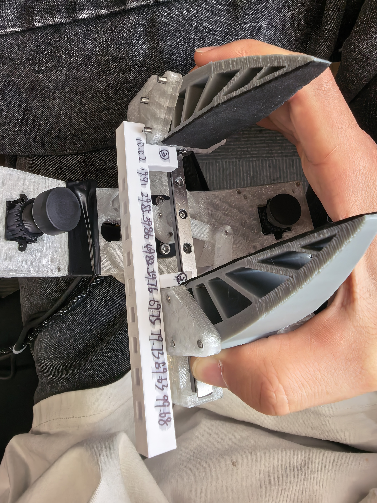

# x86 ArUco 数采工作台

独立入口：`python3 -m insight_capture.aruco_capture.app`。不启动原 Dashboard、SuperPoint/SuperGlue、建图器或夹爪 VIO。算法不要求 CUDA/GPU，4090 无需参与首版定位。

## 启动

在 Ubuntu x86 主机安装 Docker 和 Compose：
```bash
# 安装 Docker
curl -fsSL https://get.docker.com | sudo sh

# 设置 Docker 开机启动
sudo systemctl enable --now docker

# 当前用户加入 docker 组
sudo usermod -aG docker $USER

# 安装 Docker Compose v2
sudo apt update
sudo apt install -y docker-compose-v2

# 查看版本
docker --version
docker compose version
```

然后在本分支根目录执行：

```bash
# 首次构建
docker compose -f deploy/aruco/compose.yml build
docker compose -f deploy/aruco/compose.yml up -d

# 重新构建
docker compose -f deploy/aruco/compose.yml up --build -d
```

浏览器访问 `http://localhost:8770`；其他电脑访问部署主机的局域网地址、端口 `8770`。

```bash
docker compose -f deploy/aruco/compose.yml logs --tail=100
docker compose -f deploy/aruco/compose.yml down
```

没有 Compose 插件时，也可直接运行（需 BuildKit，Dockerfile 使用了 cache mount）：

```bash
docker build -f deploy/aruco/Dockerfile -t insight-aruco-capture:local .
mkdir -p outputs/aruco-capture outputs/lerobot_datasets
docker run -d --name insight-aruco-capture --network host --init \
  --restart unless-stopped --stop-signal SIGINT \
  -e RMW_IMPLEMENTATION=rmw_fastrtps_cpp \
  -e ARUCO_DEVICE_ROOT=/host-dev \
  --device-cgroup-rule='c 81:* rw' \
  --device-cgroup-rule='c 188:* rw' \
  --device-cgroup-rule='c 166:* rw' \
  -v /dev:/host-dev:ro \
  -v "$PWD/config/devices/x86-aruco/capture.json:/app/config/devices/x86-aruco/capture.json" \
  -v "$PWD/outputs:/app/outputs" \
  insight-aruco-capture:local
```

镜像默认使用腾讯云 pip 源、Aliyun apt 源和 USTC ROS 2 apt 源，x86（amd64）和 Jetson（arm64）都适用。如需更换，可在构建命令中添加 `--build-arg PIP_INDEX_URL=...`、`--build-arg APT_MIRROR=...`（只写主机，如 `http://archive.ubuntu.com`，路径自动保留）或 `--build-arg ROS_MIRROR=...`，仅影响镜像构建，不修改主机全局配置。不要把 pip 源设为 Aliyun：它对 HTTP/1.1 限速约 160 KB/s，而 pip 只使用 HTTP/1.1。也不要用 USTC：它把大文件重定向到清华，部分网络（如 Jetson 所在网络）会被返回 403。

停止用 `docker stop insight-aruco-capture`，再次启动用 `docker start insight-aruco-capture`，日志用 `docker logs --tail=100 insight-aruco-capture`。代码修改后重新构建镜像并重建容器，录制数据保留在宿主机目录；配置修改只需停录后重启容器。

这是独立服务和端口，不需要切换原 Dashboard 的 live profile。已有 Python/ROS 环境也可以直接运行：

```bash
source /opt/ros/humble/setup.bash
python3 -m insight_capture.aruco_capture.app --config config/devices/x86-aruco/capture.json
```

依赖见 `deploy/aruco/Dockerfile`。镜像使用 ROS Humble/Ubuntu 22.04 的多架构基础镜像，不包含 Jetson、TensorRT、模型权重或浏览器。相机发现使用 host 网络；设备须与主机网络互通，`ros_domain_id` 须与 Insight9 一致。

使用方式参考如下视频：

<video src="./source/二指UMI数采指南.mp4" controls width="360"></video>

（GitHub 网页预览支持直接播放内嵌视频；若在不支持 `<video>` 标签的 Markdown 查看器里看不到播放器，可点击 [二指UMI数采指南.mp4](./source/二指UMI数采指南.mp4) 下载后用本地播放器打开。）

## 配置输入

唯一入口为 `config/devices/x86-aruco/capture.json`：

- `ros_domain_id`：须与 Insight9 实际广播使用的 ROS domain 一致，不能照抄模板默认值——不同设备/网络需要用 `ros2 topic list`（配合 `ROS_DOMAIN_ID=<N>` 逐个试）实测确认。
- `head`：Insight9 已校正 RGB、CameraInfo、原始 VIO 话题（`image_topic`/`info_topic`/`vio_topic`），以及 IMU/RGB TF frame。三个话题各自独立订阅——只有确认对应话题真的存在发布者时才会绑定，不会对着空话题空等；没有内参、外参或新鲜 VIO 时不能起录。头部相机物理安装方向是横的，`capture.py` 会把每一帧顺时针旋转 90° 后再写入实时预览、录制的 `capture.sqlite3` 和最终导出的视频；这个旋转不是配置项，只影响人眼看到/导出的画面字节，ArUco 位姿检测继续用旋转前的原始帧和未变的相机内参，互不影响。
- `arms`、`tcp`、`cube_marker_relative_localization.targets`：左右手标记编号、几何及既有硬件外参，`camera` 字段用 `gripper_left`/`gripper_right` 命名（对应主 Dashboard 里的 `insight3_b`/`insight3_a`）。沿用当前硬件，无须夹爪相机上报 VIO；cube 标记具体布局和坐标系见 [Cube Marker 布局](#cube-marker-布局)。
- `rgb`：附加相机列表，当前实际部署为 4 路 UVC（左右手各上/下两路），**每次更换主机都需要使用 `ls -l /dev/v4l/by-path` 命令确认相机输出的路径**。除 `name`/`device`/`width`/`height`/`fps` 外，还支持：
  - `auto_exposure: false`：关闭自动曝光（不写这个字段则维持相机驱动默认的自动曝光）
  - `exposure_time_absolute`：配合 `auto_exposure: false` 固定曝光时间，取值范围因相机而异，用 `v4l2-ctl -d <device> --list-ctrls-menus` 查具体相机支持的区间；不填则冻结在切换到手动模式那一刻的自动曝光值上，不会再变
  无对应设备时显示缺失并降低有效率。
- `serial`：编码器输入列表，`hands` 字段取 `"left"`/`"right"`（一个串口只对应一只手的单通道编码器）或 `"both"`（同一个串口输出双手数据）。
- `fps`：导出与 QC 的统一采样率，同时也是实时页视频预览与状态轮询的节奏（页面右上角可直接改，改完立即生效；仅影响下次开始录制起的导出网格，不影响已录数据）。原始输入按实际收到的数据保存。当前配置为 `30`（等于 Insight9 实际帧率，每一行对应一帧头部图像）；不能超过 Insight9 帧率，否则必然有行找不到头部帧。对齐以 Insight9 帧为主时钟，取其他不超过帧率的值也不会再产生节拍性缺失，原理见 [位姿与有效性](#位姿与有效性)。页面上改采样率时，连续按上下键会在停顿约 0.6 秒后才提交一次，回车或移开焦点立即提交，超出 1–120 会提示并恢复原值。

USB RGB 示例，替换 `rgb` 中对应项：

```json
{"name":"rgb_left_up","device":"/dev/v4l/by-path/pci-0000:00:14.0-usb-0:4:1.0-video-index0",
 "width":1280,"height":720,"fps":30,"auto_exposure":false,"exposure_time_absolute":156}
```

原始 ROS Image 示例：

```json
{"name":"rgb_left","topic":"/rgb_left/image_raw","compressed":false}
```

编码器实际使用的是 MT6701 磁编码器固件的单通道协议，每行 JSON：

```json
{"raw":1234,"angle_degree":12.34,"opening_mm":56.78}
```

固件还会输出 `{"info":"..."}`/`{"error":"..."}` 状态行（工作台会解析并显示，不当作开合度数据）。对应配置：

```json
{"device":"/dev/serial/by-id/usb-Espressif_USB_JTAG_serial_debug_unit_XXXX-if00",
 "baudrate":115200,"hands":"left",
 "left":{"scale_m":1,"offset_m":0,"max_width_m":0.10}}
```

`scale_m`/`offset_m` 是在固件已经算出的 `opening_mm`（毫米）基础上再做一次线性修正，默认 `scale_m:1,offset_m:0` 即直接信任固件读数（只做 mm→m 单位换算）。旧的"一行 JSON 同时输出双手"协议（`{"left":1234,"right":5678}`）仍兼容，`hands` 设为 `"both"` 即可。Compose 已挂载动态设备目录并允许 V4L2、USB 串口和 ACM 串口节点；无需事先写死设备编号。硬件协议如有变化只修改 `sources.py` 的 `serial_worker` 读取函数。

## 热插拔与扫描端口

实时采集页展开“设备连接与端口”，点击“扫描设备”，为各路 RGB 选择 USB 视频端口，或保留原 ROS 话题；编码器可选一个双手串口，或两个分别对应左右手的串口，并填写波特率。点击“应用设备选择”后立即重连，无需重启服务。录制期间允许扫描，停止录制后才能换绑。

- USB 相机和串口在启动时可以缺席；断线、读取失败或持续 4 秒无数据后关闭旧连接，每秒重试一次。每路 USB 相机由一个可终止的读取子进程（`v4l2_reader.py`，OpenCV 直接读 V4L2）负责，避免驱动阻塞拖住工作台：它原样透传相机输出的 MJPEG（不解码、不重新编码），并给每帧附上 V4L2 内核采集时间戳，经管道交给主进程。实测拔线（读取进程退出）约 1.5 秒恢复，驱动卡死约 4 秒后被看门狗杀掉并在约 6.5 秒恢复。
- 成功收到图像或有效编码器数据后，自动清除对应设备的故障；其他设备故障和 VIO 重置等录制错误保留。原始采集缺失时间仍进入 QC，重连不会补造数据。
- 扫描只枚举视频采集节点，过滤元数据节点。优先绑定 `/dev/v4l/by-id/`、`/dev/serial/by-id/` 的设备标识；没有设备标识时使用 `by-path` 的 USB 插口标识。编号改变后会重新解析链接；既没有稳定标识又更换了编号时，请重新扫描选择，不能自动猜测左右设备。
  - **已知坑**：同型号 UVC 相机（本机用的 DECXIN）经常上报**完全相同**的 `by-id` 厂商字符串，多台同型号相机接上后 `/dev/v4l/by-id/` 只解析得出一组符号链接，没法用它区分具体是哪一台——这种情况必须改用 `by-path`（USB 物理插口）绑定，重插到别的口才需要重新扫描，不能指望 by-id 兜底。
- 页面选择保存到 `outputs/aruco-capture/_devices.json`，下次启动自动加载。要调整串口数值到米的标定，可修改该文件对应 `left`/`right` 标定字段后重启，或清除覆盖文件后使用模板配置。
- 应用设备选择成功后，RGB/串口绑定还会**顺带同步写回** `config/devices/x86-aruco/capture.json`（Compose 把它挂载为宿主机可写，不再是 `:ro`），这样换了主机、换了 USB 口重新扫描绑定一次之后，模板文件本身就是最新的 by-path/by-id，不用再手动编辑 JSON；这一步是尽力而为，写失败（比如还没用新版 compose 重建、挂载仍是只读）只会在容器日志里打一行提示，不影响本次设备切换本身。
- 每路 RGB 的采集帧率（`fps`）可以在设备面板里改，和选设备端口用的是同一个"应用设备选择"流程，提交后会重启对应的读取子进程。注意这只是向相机**请求**的帧率：当前 DECXIN 相机在 MJPEG 1280×720 下只支持 60 fps（`v4l2-ctl --list-formats-ext` 只列出一个 60 fps 档位，30 fps 只有 640×480 YUYV），所以配置写 30 也会以 60 fps 运行；页面显示的是实测帧率。
- UVC 采集固定请求 MJPEG（读取进程里设置 `MJPG` 格式），否则可能协商到 YUYV 模式——同分辨率下 YUYV 明显更慢（720p 下 YUYV 只有 10fps，MJPG 60fps）。某路 RGB 实测帧率明显低于预期时，先用 `v4l2-ctl -d <device> --list-formats-ext` 确认该分辨率下各格式的帧率上限。
- Insight9 图像、CameraInfo、TF 和 VIO 继续使用原 ROS 配置；扫描 USB 相机不会替代 Insight9 的 ROS/VIO 驱动。VIO 接收中断超过 2 秒后恢复，会更换轨迹参考系代次；正在录制的后续位姿无效，需要停止后新建录制，避免拼接未知坐标系。
- **Insight9 掉线自动重连**：ROS2 的中间件（`rmw_fastrtps_cpp`/`rmw_cyclonedds_cpp`，从 ROS2 Foxy 起）是"一个进程一个 DDS Participant"，不是"一个 Node 一个 Participant"——网络接口扫描只在进程启动那一刻做一次。如果 Insight9 的 USB 网卡（ROS Native 模式下表现为一张 `169.254.x.x` link-local 接口）是在容器**启动之后**才插上的，光等待或重新订阅是发现不了的，必须重建整个 rclpy 参与者才能重新扫描接口。工作台内置了一个后台看门狗（`sources.py` 的 `watch_head_interface`，每 1 秒检查一次）：Insight9 图像/VIO 数据不新鲜时，只要**已分配 IPv4 地址的网卡集合**发生变化并稳定 3 秒，就自动重建一次 ROS 层——**只重建订阅 Insight9 的那部分**，UVC 相机和串口线程全程不受影响。之所以看"网卡+地址"而不是网卡名：Insight9 的 USB 网卡插上后会先出现、几秒后才拿到 `169.254.x.x` 地址，旧版一看到网卡名就立刻重建，DDS 参与者扫描时这张网卡还没地址、用不了，之后又不会再重试，于是一直卡在"正在重新连接"。重建后若 15 秒内仍无数据会再试，间隔 15/30/60 秒，三次都失败则提示检查 USB 网线、`ROS_DOMAIN_ID` 和话题配置，重新插拔后会自动重新开始。页面状态会显示"检测到网络变化/仍未收到 Insight9 数据，正在重建 ROS 连接（第 N 次）"。日常仍建议先插好 Insight9 再启动容器；顺序反了也不需要手动重启，插好后约 3–5 秒会自动恢复。

Docker 使用 `/dev:/host-dev:ro` 和设备 cgroup 规则允许视频（81）、USB 串口（188）、ACM 串口（166）访问，以支持启动后新增设备；不需要静态 `--device` 节点。参见 [Docker 动态设备说明](https://docs.docker.com/engine/containers/run/#using-dynamically-created-devices)。

## 夹爪开合度标定

编码器固件（MT6701 磁编码器 + ESP32）自己维护一张"角度→开合度(mm)"的分段线性表，开机从 flash 加载，没有存过标定则用出厂默认值；实际开合度换算（`angleToOpening`）在固件里完成，工作台只是转发固件已经算好的 `opening_mm`。

**标定命令协议**（`sources.py` 的 `send_serial`，通过串口下行）：
- `start_cal`：进入标定模式，固件端标定点计数清零；进入后固件的遥测行会变成只有 `{"raw":...,"angle_degree":...}`（不含 `opening_mm`），工作台据此判断"当前处于标定模式"
- `{"opening_mm": <数值>}`：把"当前角度"和"这个手动测量的开合度"记为一个标定点；必须先 `start_cal`
- `end_cal`：按角度排序、检查重复角度，写 flash 并**立即生效**；至少需要 2 个点。失败（点数不够/角度重复）时固件**不退出标定模式**，也不会用半成品覆盖旧的标定表——旧标定继续有效，可以直接补点后再次 `end_cal`

对应的 HTTP 接口：`POST /api/serial/{index}/command`（body 为 `{"command":"start_cal"}` / `{"command":"opening_mm","value":91.5}` / `{"command":"end_cal"}`），`GET /api/serial/{index}/log?after=<seq>` 增量拉取固件的 `info`/`error` 反馈和实时角度。

**页面操作**（实时采集页"设备连接与端口"→对应编码器行下方的"夹爪标定"子面板）：
1. 点"开始标定"（同一个按钮，标定中会变成"退出标定并保存"）
2. 把夹爪开到一个已知宽度，用卡尺量出毫米数或使用标定尺测量（示例见下图），填进"开合度 (mm)"输入框（步长 10），点"记录点"；至少两个不同角度重复这一步

   
3. 点"退出标定并保存"提交；面板下方日志区会实时显示固件的角度遥测、每次记录确认（"第 N 点：角度 X° → 开合度 Ymm"）和最终"标定已保存，共 N 点"或具体报错
4. 发现某个点录错了：点"重新标定"（对应 `start_cal`，固件端标定点计数清零，工作台侧也清空当页已显示的记录列表），从头补录——固件没有单点覆盖/删除命令，录错了只能整段重录，不能只改一个点

录制中或设备面板忙碌时整个标定面板会跟着其他设备控件一起禁用。

## 采集与标注

1. 确认头部标定、图像和 VIO 就绪，检查左右 cube 位姿；顶部“录制名称”输入框可自定义本次录制的名称（默认 `My_Capture`，只能含字母、数字、下划线、短横线），开始录制后目录名为 `<名称>_<时间戳>`，同名同秒冲突会自动加序号后缀。
2. 停录后进入“回放与标注”。录制记录下拉列表按时间倒序排列，尚未标注的录制会带“· 未标注”后缀；列表右侧“刷新列表”按钮之后另有“上一项/下一项”按钮，可在已停止的录制之间快速切换。播放、暂停、逐帧、倍速和拖动时间轴都会同步各路视频、3D TCP 与开合度。按空格播放/暂停，左右方向键逐帧，I/O 设置片段起止点。
3. 设置片段起止时间、任务文本 task、子任务文本 subtask（可留空）和参与手臂（左手、右手、双手），添加或编辑片段后保存全部标注。片段不允许重叠；切换录制或关闭页面前提示未保存修改。“静止分段”按钮切出 task 级的动作片段（任务文本为空），供人工填写或作为预标注的输入；点击后会覆盖当前未保存的片段列表，保存前可点击“撤销静止分段”撤回。逻辑（`dataset.py` 的 `suggest_pause_segments`，静止检测移植自 main 分支 `auto_pause`）：

   | 参数 | 值 | 含义 |
   |---|---|---|
   | `DEFAULT_IDLE_LINEAR_SPEED_M_S` | 0.02 m/s | 单只手线速度阈值 |
   | `DEFAULT_IDLE_ANGULAR_SPEED_DEG_S` | 10 °/s | 单只手角速度阈值 |
   | `DEFAULT_IDLE_GRIPPER_SPEED_M_S` | 0.005 m/s | 夹爪开合速度阈值 |
   | `DEFAULT_IDLE_GAP_TOLERANCE_S` | 0.15 s | 停顿中允许的短暂抖动 |
   | `DEFAULT_IDLE_DURATION_S` | 2 s | 停顿至少这么长才算 task 之间的停顿 |
   | `DEFAULT_MINIMUM_SEGMENT_DURATION_S` | 1 s | 短于此的零碎动作丢弃 |

   1. 逐帧计算两只手的线速度、角速度和开合速度，三项都低于阈值算这只手静止；两只手同时静止且该帧位姿与全部视频有效，才算停顿（缺失或跳变数据不会被误判为停顿）。停顿中间短于 0.15 秒的运动视为抖动并入停顿。
   2. 停顿持续 2 秒以上视为 task 之间的停顿（操作者在复位现场，没有训练价值）：**不论多长，整段丢弃**。片段从动作开始的那一帧起、到动作结束的那一帧止，录制首尾的长停顿同样去掉。短于 2 秒的停顿（subtask 之间）留在片段内，由预标注模型切分。
   3. 短于 1 秒的零碎动作（如复位时碰到夹爪）丢弃；每段起止再收缩到段内第一 / 最后一个全部维度有效的帧，不超出录制时长。

   被丢弃的停顿不属于任何片段，导出时也不会进入数据集。以 `atom_action_set_1-1`（98 秒）为例，切出 5 段、保留 81 秒；`atom_action_set_2-1`（186 秒）切出 10 段、保留 142 秒。

   填写任务有交互引导：“动作片段”列表顶部的步骤条（生成片段 → 选择片段 → 填写任务 → 保存）高亮当前所在步骤，下面一行给出当前该做什么，进度条显示已填写比例。未填写任务的片段在列表中显示为橙色斜体“未填写任务”、在时间轴上显示为橙色虚线斜纹块；正在编辑的片段在列表和时间轴上用青色描边，回放光标所在的片段整行微亮并标注“播放位置”。静止分段后会直接打开第 1 段并聚焦任务输入框，输入任务后按回车即更新本段并跳到下一段未填写的片段；“下一段未填写 ›”按钮可随时跳转（会先保留当前已输入的内容）。若一条录制重复做同一个任务，可在任务框下点“把此任务文本也填到其余 N 段未填写片段”一次填完，提示栏可撤销。全部填写后“保存全部标注”按钮会闪烁提示；仍有未填写片段时点保存会被拦下并定位到第一段未填写的片段。

   时间轴下方“动作片段”旁有“分隔”和“合并”按钮。“分隔”在当前播放位置把所在片段切成两段（播放位置须离起止点至少 1 帧）：前段保留原片段的 task、subtask 和参与手臂，后段为空白（双手、未填写），并直接打开后段待填写。时间轴色块或片段列表上，普通点击打开编辑并选中一段，Ctrl（macOS 为 ⌘）点击增减选中，Shift 点击选中从上次点击到当前的连续范围，选中的片段有白色描边；选中两段及以上后点“合并 N 段”，合并为从最前一段起点到最后一段终点的一段，保留最前一段的属性。只能合并相邻片段，中间隔着未选中的片段会被拒绝。分隔和合并都可在提示栏撤销，正在编辑且未更新的片段需先更新；都要“保存全部标注”后才生效。

   删除片段：点选片段（Ctrl / Shift 可多选）后按 Del，删除选中的片段；没有多选时删除编辑区里打开的那一段。正在文本框里输入时 Del 只删字符。删除可在提示栏撤销，保存后生效。

   动作表：编辑区上方的“导入动作表”上传 JSON 或 CSV 格式的 task / subtask 词表，后端校验后保存为 `outputs/aruco-capture/_action_table.json`，所有录制共用；每次导入另存一份到 `outputs/aruco-capture/_action_tables/<时间>_<版本>.json` 留档，重新导入即替换当前表。格式见示例 `config/devices/x86-aruco/action_table.example.json` 与 `.csv`：
   - JSON：`{"version": "...", "tasks": [{"id", "text", "zh", "description", "subtasks": [{"id", "text", "zh"}]}]}`，`id` 只能用英文字母、数字和 `_ . -`，`text` 为标准英文说法，`zh`、`description`、`subtasks` 可省略；task id 不可重复，同一 task 下 subtask id 不可重复（不同 task 可复用同一 subtask id）。`version` 省略时取文件名。
   - CSV：表头 `task_id,task,task_zh,subtask_id,subtask,subtask_zh`，每行一个 subtask，同一 `task_id` 的后续行可省略 task 文本；`subtask_id` 为空的行只声明 task。UTF-8 或 Excel 中文系统另存的 GBK 编码都可读。

   **采集指导动作表**：`config/devices/x86-aruco/atom_action_set_collect_director.xls`（采集指导表原件，Excel `.xls`，不能直接导入）已转换为可导入的 `atom_action_set_collect_director.json`（推荐，版本 `atom-collect-director-v1`）和同内容的 `.csv`（带 BOM 的 UTF-8，方便在 Excel 里修改）。转换规则：
   - 表格的每一行是一个 task：`atom_action_set` 的 18 行记为 `a01`–`a18`，`demo_set` 的 3 行记为 `d01`–`d03`，id 形如 `a04_cup_left_to_right_left`；`text` 为人工补写的英文标准说法，`zh` 为原中文描述（描述本身不含手臂的，前面加“左手：/右手：/双手：”）。原表第 5、7 行描述为空，沿用上一行描述、换成右手。
   - 类别、手臂、注意事项和采集次数写进 task 的 `description`（如 `atom_action_set #4 · 类别：抓取与放置 · 手臂：左手 · 注意：杯子的开始位置、放置位置随机 · 采集 5 次`），在下拉选项上悬停可见，也会写进给预标注模型的提示里。CSV 没有 `description` 列，所以只有 JSON 带这些信息。
   - 原表没有 subtask 列，subtask 按描述拆到“对哪个物体、用哪只手、放到哪里”的单步动作（共 128 个），抓取与放置分开、带上位置或序号。例如：
     - 移动与开合：闭合、打开、向前、向后、向左、向右、向上、向下各一步；
     - 抓放杯子（`a04`–`a07`）：抓取桌面左侧的杯子 → 提起 → 搬到右侧 → 放在桌面右侧 → 松开并移开；
     - 翻转（`a11`）：左手抓取 → 左手翻转 → 放回原位，右手再重复一遍；倒扣（`a12`）按中间 / 左侧 / 右侧纸杯命名，不规定先后，原表要求“多多改变动作顺序”；
     - 毛巾（`a14`–`a16`、`d03`）：抓住两角 → 沿中线对折 → 松开 → 抓住上层两角 → 拉回展开 → 松开；
     - 堆叠（`a17`、`a18`）：一只手拾起第一个杯子并保持静止，另一只手依次拾起第二、第三个杯子叠上去；
     - 取杯（`d01`）：从堆栈顶部依次取出第一个……最后一个杯子，各自放在堆栈旁；
     - 叠塔（`d02_cup_pyramid`）：每个杯子的取出和摆放位置，按底层自左向右（桌面中央偏左、中央、中央偏右）、第二层左右、塔顶的顺序，共 12 步。

     其中有几处是按常见做法补的假设，需对照实际采集方式核对：`a08` 三个物体只写“放到另一个物体原来的位置”，不规定互换顺序；横向 / 竖向对折写成“近边叠到远边”“左边叠到右边”；`d03` 写成对折两次；`d01` 写成取出后放在堆栈旁。拆法如需调整，改 CSV 或 JSON 后重新导入即可。原表的 `prompt` 1/2/3 列为空，未转换。

   导入方法（二选一，导入一次即对这台采集机上的所有录制生效）：
   1. 网页：“回放与标注”页选中任一录制，在编辑区上方点“导入动作表”，选择 `atom_action_set_collect_director.json`（文件需在打开网页的这台电脑上，可从仓库复制）。成功后提示栏显示“已导入动作表 atom-collect-director-v1（21 个 task）”，task / subtask 输入框上方出现下拉框。
   2. 命令行（在仓库根目录执行，`<采集机>` 换成采集机地址，本机为 `127.0.0.1`）：

      ```bash
      python3 -c 'import json, sys; print(json.dumps({"filename": sys.argv[1].rsplit("/", 1)[-1], "content": open(sys.argv[1], encoding="utf-8").read()}))' \
        config/devices/x86-aruco/atom_action_set_collect_director.json \
        | curl -s -X POST http://<采集机>:8770/api/action-table -H 'Content-Type: application/json' -d @- \
        | python3 -c 'import json, sys; t = json.load(sys.stdin); print(t.get("error") or "已导入 %s：%d 个 task" % (t["version"], len(t["tasks"])))'
      ```

   导入后可用 `curl -s http://<采集机>:8770/api/action-table` 查看当前表；修改表格后重新导入会替换当前表，旧版本留在 `outputs/aruco-capture/_action_tables/`。

   导入后，task 和 subtask 输入框上方各出现一个下拉框：选中动作表条目时，文本框为空或仍是某条标准说法则预填所选条目的标准说法；已改写成自己措辞的文本保留不动。文本可以自由改写（同一动作用不同表达，用于训练语言理解），下拉框记录的是标准 id。subtask 下拉只列所选 task 下的条目。不选 task 即为表外动作，只填文本也能保存，但片段列表会标“表外”并统计“N 段未关联动作表”；片段引用的 id 已不在当前表中时同样标“表外”，下拉框保留该 id 并注明“当前动作表中已无”。“把此任务文本也填到其余未填写片段”会一并带上所选 task id。对应接口 `GET /api/action-table`、`POST /api/action-table`（请求体 `{"filename", "content"}`）。
   预标注（可选）：在有 GPU 的机器上单独运行推理服务 `insight_capture.vlm_service`（默认 Qwen3.8-27B-FP8，约 30 GB 显存，目前运行在 229（`10.198.1.229:8780`，RTX 4090 48 GB）；也兼容 Qwen2.5-VL-7B，约 17 GB。216 的 RTX 3080 10 GB 都放不下），采集服务通过 `ARUCO_ANNOTATION_URL` 指向它：

   ```bash
   # GPU 机器上，首次：建环境（固定版本见 deploy/vlm/requirements.txt）并取 FP8 内核，下载权重，复制配置后按本机修改 MODEL / PYTHON
   deploy/vlm/setup_env.sh --fetch-kernel
   uvx modelscope download --model Qwen/Qwen3.8-27B-FP8 --local_dir ~/Workspace/Qwen3.8-27B-FP8
   cp deploy/vlm/vlm.env.example deploy/vlm/.env
   deploy/vlm/vlm_service.sh start    # 后台启动，加载并预热后返回；另有 stop / restart / status / logs / run
   # 采集机上：写入 deploy/aruco/.env 后重建容器
   echo ARUCO_ANNOTATION_URL=http://10.198.1.229:8780 > deploy/aruco/.env
   docker compose -f deploy/aruco/compose.yml up -d
   ```

   - **服务地址**：回放页预标注栏的“服务设置”可直接修改推理服务地址（主机与端口，如 `10.198.1.229:8780`，可省略 `http://`），点“保存并测试”立即生效并显示能否连上，保存在 `outputs/aruco-capture/_annotation.json`；页面上保存过之后以它为准，`ARUCO_ANNOTATION_URL` 只作为从未设置时的默认值。清空地址即停用预标注。推理服务自身的监听端口由 GPU 机器上 `deploy/vlm/.env` 的 `PORT` 决定，两边需一致。
   - **录制结束自动静止分段**：每次停止录制后，后台先按“静止分段”的规则（同一组分段参数）切分，结果存为这条录制的草稿 `segments_draft.json`（`source: pause`，任务待填写）；打开还没有标注的录制时自动载入这份草稿，预标注栏显示“静止分段草稿 N 段”。推理服务可用时随后进行模型预标注，用带任务文本的草稿替换它。一键预标注的“只处理缺失”把只有静止分段草稿的录制视为尚未预标注。
   - **只在服务可用时运行**：每次停止录制后，后台用几秒超时探测一次服务的 `/health`；没配置地址或连不上就直接跳过（日志一行 `pre-annotation skipped`），不重试、不影响录制和保存，照常手动标注。服务后来才启动的录制，可在回放页点编辑区底部的“预标注”补跑。预标注一次只跑一条（排队），不阻塞开始下一次录制。
   - **流程**（`preannotate.py`）：
     1. 静止分段切出 task 级的动作段（见上，复位停顿丢弃）。
     2. 认 task：把全部动作段按约 1 帧/秒（最多 200 帧）送给服务的 `/v1/task`，模型从动作表中选出整条录制的 task，并写一句改写的英文说法。
     3. 切 subtask：每个动作段按 4 帧/秒、最长边 448 像素送给 `/v1/segments`，提示里给出所选 task 的 subtask 列表、采集说明以及“subtask 通常按列出顺序执行并整组重复”，模型输出带起止时间的 subtask 片段；超过 45 秒的动作段按 40 秒窗口（重叠 5 秒）切开，重叠部分各取一半。
     4. 位姿修正：片段起止吸附到 0.75 秒内最近的运动起止点（两只手任一在动即算运动）；参与手臂按位姿判断（某只手的运动时间不到另一只手的 30% 记为单手，否则双手）；`move_left/right/forward/backward/up/down` 与 `close_gripper/open_gripper` 这类 subtask 用重力对齐坐标系下的位移方向（取有效帧、5 帧中值滤波后偏离起点最远处，需 ≥ 3 cm）和开合度变化（≥ 2 cm）校验，不符的标为存疑并写明位姿显示的方向。
     5. 补满：每个静止分段区间都被草稿片段完整覆盖。模型没覆盖到的时段（≥ 0.3 s）单独成段，短于 0.3 s 的空隙并入相邻片段；没覆盖的时段，以及模型给不出 task 或 subtask 的片段，task / subtask 都写为 `other`（不关联动作表 id），并标为存疑（“不确定或无法标注，标为 other”）。`atom_action_set_3-1_20261104_110448` 上 5 个区间共 117.2 s 覆盖 100%，81 段中 30 段为 other。
     模型写成中文的文本会被丢弃，id 缺失但文本与标准说法一致时自动补上 id；录制没认出 task 时，所有片段标“未确定 task”。
   - **草稿**：结果写入录制目录的 `segments_draft.json`：顶层 `task`（task_id、改写说法、中文概括），每段带存疑原因 `flags`；从不覆盖 `segments.json`。存疑包括：模型输出无法解析、未能匹配动作表、id 不在所选 task 中、文本为中文、位姿与 subtask 不符、模型未切分出子任务（整段保留）、推理请求失败等。
   - **效果**（Qwen3.8-27B-FP8，4090，以位姿推出的动作作参照，只能评估“移动与开合”类 task）：`atom_action_set_1-1`（98 秒，33 个动作）用时 119 秒，task 认对，subtask 准确率 64%，边界误差中位数约 0.13 / 0.24 秒（起 / 止），35 段中 14 段存疑且都指向真实问题；`atom_action_set_2-1`（186 秒，68 个动作）用时 201 秒，task 认对，subtask 准确率 72%，边界误差约 0.17 / 0.30 秒。旧做法（0.8 秒停顿切段后逐段识别）在 1-1 上约三分之一正确。换用 Qwen3.8 而不是 Qwen2.5-VL-7B，是因为 7B 常把夹爪上的标记方块当成被操作的物体、改写多半照抄标准说法。服务启动时先用合成画面推理一次做预热（首次在一台机器上编译 GPU 内核约 1.5 分钟，之后有缓存），预热完 `/health` 才应答。Qwen3 系列关闭思考模式，模型被要求 task / subtask 都写成以动词开头的英文祈使句。
   - **前端确认**：编辑区的预标注栏显示服务与草稿状态；“预标注 / 重新预标注”按钮与“静止分段”“添加片段”并排在编辑区底部，“保存全部标注”单独靠右。打开一条还没有任何标注的录制时自动载入草稿（未保存，可撤销）；已有标注时可点“载入草稿”替换。预标注栏显示识别出的 task；存疑片段带红色“存疑”标签（悬停看原因）；打开片段并“更新片段”即视为确认、清除存疑标记。保存时只写人工确认的字段，导出流程不变。
   - 接口：`GET /api/annotation/service`（服务配置与健康状态）、`POST /api/annotation/service`（请求体 `{"url"}`，修改地址）、`GET /api/sessions/<录制名>/draft`（草稿与任务进度）、`POST /api/sessions/<录制名>/draft`（手动预标注，服务不可用时报错）。推理服务本身：`GET /health`、`POST /v1/task`、`POST /v1/segments`（请求与返回见 `insight_capture/vlm_service/server.py` 开头）。

4. 采集质量（各维度有效率、缺失时段、20 维详细统计、可导出片段/帧数）显示在“回放与标注”页下方，跟随当前选中的录制；点击缺失区间回到相应时刻检查；预估和最终导出共用有效区间计算。

   质量统计范围（右上角切换）：默认“全部分段”，只统计当前分段（含未保存的修改、载入的草稿）覆盖的时间，分段之外的空档不计入；“固定分段”只统计选定的一段（下拉切换，或在“各分段质量”列表里点击），“全部视频”即整条录制（含 20 维详细统计）。分段范围下另列“各分段质量”：每段的完整有效率和最低的维度，点击即固定到该段并跳到其起点。分段内的有效率由整条录制的缺失时段按分段裁剪后计算。“处理与导出”页同样显示这一质量板块，录制列表每行的“查看质量”载入该录制。没有分段时只能看全部视频。

   **批量处理**（“回放与标注”页录制选择栏下方）：
   - “全部离线重算”：对所有已停止的录制依次离线重算；默认“只算尚未重算的”，勾掉则全部重算。可勾“快速模式”（见下文离线重算一节）。进度、跳过与失败条数显示在按钮旁。
   - “全部预标注”：推理服务可用时，为录制排队生成预标注草稿；默认“只标尚未标注的”（跳过已有标注或草稿的录制）。完成后逐条打开录制即会自动载入草稿，人工核对后保存。
   - 编辑区底部的“静止分段参数”可修改最短停顿时长、静止线速度 / 角速度 / 开合速度上限、停顿内允许的短暂运动和最短片段时长（各有取值范围，“恢复默认”还原），保存在 `outputs/aruco-capture/_segment_settings.json`，所有录制共用；“静止分段”按钮和预标注都按这里的参数切分。接口：`GET/POST /api/segment-settings`、`GET/POST /api/pose/recompute-all`（请求体 `{"only_missing", "fast"}`）、`POST /api/drafts/run-all`（`{"only_missing"}`）、`GET /api/drafts`。

工作台使用深色布局，左手蓝色、右手橙色。实时页显示输入接收频率、相机/VIO/内外参状态、cube 标记与重投影误差、TCP 坐标和串口开合度。无数据时明确显示等待或无效，不填充演示数值。

3D 轨迹使用仓库已有 Babylon.js，在本地提供资源，网页无需访问 CDN。默认使用相机视角（沿头部相机光轴、从相机后方 0.6 m 处看，原点即相机位置保持在画面中央；视场角按内参计算，z 轴朝上），也支持旋转、平移、缩放、适配（从后上方透视，框住全部轨迹与原点）、俯视/正视/侧视（正交投影：俯视 Y 朝上、正视从后方沿 Y 看、侧视从右侧看）和全屏；坐标单位米，网格间距 0.1 m；重力对齐的录制里网格水平铺在轨迹最低点下方（按 0.1 m 取整，标注其 z 高度），原点有虚线垂直连到网格，TCP 附带 XYZ 朝向轴。无效帧和超过 0.3 秒的间隔会断开轨迹。实时轨迹保留约 4 分钟、最多 2400 次观测，开始新录制或 VIO 重置时清空旧参考系轨迹；离线回放显示整次录制轨迹，长录制只抽稀绘制点，不改变原始数据和 QC。

视频预览为按需 JPEG，实时界面最高约 5 次更新/秒；回放拖动时间轴时，3D 轨迹光标和左右手 TCP/开合度会**立即**按拖动位置更新（`review.rows` 已整个加载在浏览器内存里，纯本地数组查找，不受视频影响）；视频画面仍按浏览器实际请求与解码速度显示，快速拖动时可能滞后于当前光标位置几帧，不能把网页视频显示速率当作输入帧率。采集和导出使用原始输入与配置采样率。

原始数据位于 `outputs/aruco-capture/<名称>_<时间戳>/`：

- `capture.sqlite3`：图像载荷、头部 VIO、左右 TCP 检测及串口原始数值。ROS 回调只排队，写盘和检测在一个独立线程。
- `session.json`：配置、标定、参考变换、时长及错误记录。
- `segments.json`：人工确认的时间范围、`task` 任务文本、`subtask` 子任务文本（可为空，旧标注视为空）、`task_id` / `subtask_id` 动作表 id（可为空，表示表外动作）及 `hands` 参与手臂（旧标注默认 `both`）。
- `quality.json`：全录制预期时间轴上的有效帧占比。
- `segments_draft.json`：自动预标注草稿（配置了推理服务才有），只用于前端预填。
- `pose.json`：这条录制选用的轨迹来源（实时/离线）、低通截止频率和离线重算信息；没有此文件时按默认值（实时轨迹、`pose_filter_hz`）。
- `pose_offline.sqlite3`：离线重算得到的位姿（点过“离线重算”才有），与 `capture.sqlite3` 中的实时位姿格式相同；原始录制不会被修改。

导出统一走“累加导出到统一数据集”（见下一节），不再单独导出到每次录制自己的子目录。

删除录制：“回放与标注”页录制列表右侧的“删除录制”删除当前选中的一条；“处理与导出”页勾选若干条后点“删除选中录制”批量删除。两者都会弹窗二次确认，确认后整个录制目录（原始 SQLite、`session.json`、`segments.json`、`quality.json`）被永久删除、不可恢复；已经导出到数据集文件夹的副本不受影响。正在录制或正在导出的那条录制会被拒绝删除。对应接口为 `DELETE /api/sessions/<录制名>`。

停录会排空已入队的数据并提交数据库。异常中断的会话保留原始 SQLite，首版不自动恢复或导出未正常结束的录制。

## 位姿与有效性

每次录制以**第一帧能够与头部 VIO 同步的 RGB 所对应的 IMU 位姿**为原点，建立**重力对齐**的固定参考系。双臂共用该参考系；不同录制的原点和朝前方向独立：

- `z` 轴：重力的反方向（竖直朝上）；
- `y` 轴：头部相机光轴在水平面上的投影（朝前）；
- `x` 轴：`y × z`（朝右）。

重力方向取自 Insight9：使用 VIO 时取 VIO 世界坐标系的 z 轴（Insight9 VIO 世界系本身与重力对齐、z 朝上）；关闭 VIO 时取 `imu_topic`（默认 `/base_insight9/camera/imu`）加速度计的低通结果，按消息 `frame_id` 经 TF 转到 `imu_frame`，未收到 IMU 前不能起录。光轴接近竖直（与水平面夹角超过约 84°）时无法确定朝前方向，会报错。`session.json` 记录 `reference_frame` 与参考时刻的相机位姿 `reference_from_rgb`；LeRobot 导出的 `coordinate_frame` 写明所用坐标系。此前的录制没有 `reference_frame`，仍是旧的相机 IMU 坐标系，离线重算沿用录制时的参考系不变；累积数据集拒绝混入坐标系不同的录制。开启 VIO 录制的旧数据可用 `python3 -m insight_capture.aruco_capture.frame_migration <录制目录>...` 转换为重力对齐坐标系（`--revert` 还原）：只改 `session.json`，`capture.sqlite3` 不动——实时位姿在读取时乘上记录的 `live_pose_correction`，离线重算直接得到新坐标系；已有旧坐标系 `pose_offline.sqlite3` 的录制须先删除它。

```text
T_reference_TCP = R_gravity(start)
                × inverse(T_world_IMU_start)
                × T_world_IMU_at_image
                × T_IMU_RGB
                × T_RGB_cube
                × T_cube_camera_center
                × T_camera_center_TCP
```

头部 VIO 在图像源时间戳处插值，不外推；其累计漂移不会被 cube 定位消除。检测到头部时间回退或大幅 VIO 跳变后，本次录制后续位姿标为无效，须停止并重新录制。

**固定相机模式（不使用 VIO）**：实时采集页顶部"使用 VIO"开关默认启用；头部相机刚性固定、不会移动时可以关闭（录制中不可修改，停止后才能切换，下次开始录制起生效，设置写入 `_devices.json` 持久化）。关闭后：
- 开始录制不再要求 Insight9 发布 VIO 话题或 VIO 数据新鲜，只要求 RGB、CameraInfo 和 IMU→RGB 外参就绪。
- 位姿计算把 IMU 坐标系当作与世界坐标系重合（固定不变），上面公式里的 `T_world_IMU_start`/`T_world_IMU_at_image` 都退化成单位阵，cube 位姿完全相对这个固定相机计算，不再有 VIO 漂移或外推误差；重力方向改由 IMU 加速度计提供，开始录制还要求已收到 IMU 数据。
- 即使 VIO 话题实际仍有数据（只是没被使用），其跳变/重置也不会触发"VIO 重置，请停止后重新录制"——这个判断只在开关开启时生效。
- 热插拔看门狗（见下一节）判断"是否失联"时也会跳过 VIO 新鲜度，只看图像话题，避免固定相机场景下因为 VIO 永远不新鲜而误判。

单面标记允许定位：IPPE 候选先通过深度及重投影检查，误差接近时参考近期全局 cube 位姿选择，再检查运动跳变。没有时间先验的首帧和遮挡后重现仍有平面多解风险；不把低重投影误差当作精度证明。标记不可见不保持上一帧作为有效位姿。

左右手 TCP 卡片 `valid: false` 时附带的 `reason` 精确到具体在哪一步失败，不再笼统显示"未检测到"：

| 阶段 | `reason` | 前端文案 |
| --- | --- | --- |
| 一个 marker 都没看到 | `marker_not_detected` | 未检测到 cube |
| 看到了但不够数量要求 | `not_enough_markers_visible` | 可见标记数量不足 |
| `solvePnP`/`solvePnPRansac` 本身失败 | `pnp_solve_failed` | 位姿求解失败 |
| RANSAC 内点比例太低 | `low_inlier_ratio` | 内点比例过低 |
| 多面校正模式下有效面不够 | `insufficient_face_support` | 有效标记面不足，几何不稳定 |
| 点集几何退化（近似共面） | `degenerate_geometry` | 标记共面/退化，无法求解 |
| 解出来的深度超出合理范围 | `depth_out_of_range` | 推算深度超出合理范围 |
| 重投影误差超阈值 | `reprojection_too_high` | 重投影误差过大 |
| 与上一帧相比位姿跳变过大 | `pose_jump` | 位姿跳变，当前帧无效 |
| 头部 VIO 被重置（时间回退/大跳变） | `head_vio_reset` | VIO 重置，请重新录制 |
| 缺少同步 VIO 或内外参未就绪 | `missing_head_pose_or_calibration` | 缺少同步 VIO 或标定 |

前 8 个来自 `cube_markers.py`/`pose.py` 的 `_solve_target()`（`MultiCubeMarkerEstimator.last_reasons`，跟主 Dashboard 共用同一套检测代码，纯附加字段，不影响主 Dashboard 现有调用），后 3 个是 `pose.py` `observe()` 里已有的录制级判断。

`pose.py` 的 `DirectPose` 初始化时用 `dataclasses.replace(...)` 把 `apply_corrections` 强制设为 `False`、`min_markers` 强制设为 `1`，**不管 `capture.json` 的 `cube_marker_relative_localization.apply_corrections`/`min_markers`填的是什么都会被覆盖**——当前模板里这两个字段分别是 `true`/`1`，其中 `apply_corrections: true` 对这个独立工作台完全不生效（只有主 Dashboard 走的另一套代码路径会用到），不要指望改它能打开多面校正。真正生效、影响单标记 IPPE 候选筛选和多标记 RANSAC 的是 `min_inlier_ratio`（当前 `0.6`）、`max_reprojection_error_px`（当前 `2.5` px）、`min_depth_m`/`max_depth_m`（当前 `0.1`–`3.0` m），这几个阈值改了立即生效，不需要重新构建镜像。

### 轨迹来源、离线重算与平滑

高频抖动的来源（用 `My_Capture3-3`、`My_Capture2-2` 实测）：只看到 cube 一个面时，平面 PnP 绕面内两轴的转角约束很弱、且有两个相近解，单面帧旋转抖动 2–4°，约 25% 的单面帧与上一帧相差超过 6°（解在两支之间翻转），多面帧只有 0.6–0.8°；TCP 离 cube 中心约 14.3 cm，1° 旋转误差就是 2.5 mm 末端位移，所以 cube 中心只抖 1.5–2.3 mm，TCP 却抖 5–7.5 mm、尖峰 17 mm。另外旧版检测器用 OpenCV 默认参数，角点不做亚像素精化，约 100 px 的标记上 1 px 量化就是可观的角度误差。头部 VIO 的贡献可以忽略（0.1–0.2 mm）。

改进分三层，回放、静止分段、质量报告与导出都通过同一个 `align()` 读取轨迹，所以**回放页看到的轨迹就是导出的轨迹**：

1. **实时角点精化**：`cube_marker_relative_localization.corner_refinement` 取 `none`（旧行为）/ `subpix` / `contour` / `roi_apriltag` / `apriltag`，模板为 `contour`（不增加耗时，旋转抖动约降 40%）。`apriltag` 最准但整帧约 49 ms，超出 30 Hz 的预算；`roi_apriltag` 先快速检测再只在标记周围小块里做 AprilTag 精化，约多 7–10 ms，处理线程余量足够时可以改用。实时循环现在只解码一次头部 JPEG（旋转预览和检测共用），省出约 4 ms。只对之后的新录制生效。
2. **离线重算**（回放页 3D 轨迹面板“离线重算”按钮）：用多进程对整条录制的每一帧 Insight9 画面做全帧 AprilTag 精化检测，再按原时间顺序、原参考系、原 VIO 插值重新求解，结果写入 `pose_offline.sqlite3`，完成后自动切到离线轨迹；“轨迹来源”下拉框可随时在“实时录制/离线重算”之间切换并保存在 `pose.json`，导出使用当前选择。重算可以和录制同时进行：重算的工作进程以最低调度优先级（nice 19）运行，录制进行中自动收缩到四分之一的 CPU，录制停止后恢复；同一时间只重算一条，其余排队；正在导出的录制不能重算，重算中的录制不能导出、删除或切换轨迹。工作进程池在服务启动后的第一次重算时创建并一直复用，不再每次重启（每次省去数秒到十几秒的进程启动）；并行数默认为逻辑核数的 3/4（实测本机 32 逻辑核 / 约 16 物理核时 16–24 个进程最快，再多反而变慢），可用环境变量 `ARUCO_RECOMPUTE_WORKERS` 覆盖。

   **实时结果补帧**：离线没能解算的帧（某只手 `valid: false`），若同一帧（同一头部时间戳）的实时位姿有效，就采用实时结果并标记 `"source": "live"`；每只手补了多少帧记在 `pose.json` 的 `offline.filled_from_live`（`atom_action_set_1-1` 左 4 帧、右 2 帧）。

   **快速模式**（可选）：只在粗检出的标记附近做 AprilTag 精化（`roi_apriltag`），单帧耗时约为全帧的 1/4（本机 45 → 12 ms，216 上 80 → 38 ms）；但在 `atom_action_set_1-1` 上漏掉了约 14% 的全帧版能找到的标记、少数角点差 3 px 以上，所以默认关闭。另试过 AprilTag 四边形降采样（`aprilTagQuadDecimate`），1.5 倍时快 42% 但角点平均偏 0.4 px 并漏检，没有采用。离线检测几乎全部时间花在 AprilTag 精化上（逐帧位姿解算整条录制只占约 1.3 s），所以不降精度时只能靠多核加速。用相同检测器离线重放可与实时位姿逐帧一致（中位差 0.00 mm），说明重算链路与实时一致。本机约 165–180 帧/秒（98 秒录制约 17 s）；216（16 逻辑核）以往约 50–65 帧/秒。
3. **轨迹平滑**（“低通”输入框，默认取 `capture.json` 的 `pose_filter_hz`，模板 6 Hz，`0` 表示不平滑、显示原始位姿）：对每段连续有效帧分别处理，不跨缺失插值。先用 Hampel 滤波（7 帧窗口、3 倍稳健标准差）把单面翻转这类孤立离群帧替换为窗口中值，再对位置和（符号连续化的）四元数做 2 阶 Butterworth 前后双向滤波（零相位，不引入延迟）。截止频率须小于采样率的一半。

实测（右手，采样 30 Hz，高频抖动 = 相对 9 帧二次拟合的残差 RMS）：

| 录制 | 实时 · 不平滑 | 实时 · 6 Hz | 离线 · 不平滑 | 离线 · 6 Hz |
| --- | --- | --- | --- | --- |
| `My_Capture3-3` | 4.84 mm / 2.61° | 1.33 mm / 0.62° | 1.89 mm / 1.07° | 0.81 mm / 0.45° |
| `My_Capture2-2` | 3.38 mm / 1.76° | 0.74 mm / 0.38° | 0.86 mm / 0.49° | 0.30 mm / 0.17° |

平滑后静止检测也更可靠：`My_Capture2-2` 的静止分段从 1 段（抖动让双手始终"在动"）变为 8 段（实时 6 Hz）/ 18 段（离线 6 Hz）。这个指标会把滤波本身的效果算进去，真实精度建议把夹爪静置桌面录 10 秒看标准差。硬件上加大标记（仓库有 50/60 mm 打印模板）、让 cube 斜对头部相机露出两个面，是减少单面帧最直接的办法。

QC 报告与导出 manifest 的 `pose_trajectory` 字段记录本次使用的来源、角点精化方式和滤波参数。接口：`GET/POST /api/sessions/<录制名>/pose`（`{"source": "live"|"offline", "filter_hz": 数值}`）、`POST /api/sessions/<录制名>/pose/recompute`（后台运行，进度见 `GET .../pose` 的 `job`）。

**跨设备对齐以 Insight9 图像帧为主时钟**（`dataset.py` 的 `align()`）：

1. Insight9 图像用 ROS 源时间戳（header.stamp，间隔极稳定），整体平移到主机时间轴（偏移取"接收时间 − 源时间戳"的 1% 分位数，即最小传输延迟）。
2. QC/导出的每一行先绑定到离它最近、且在半个帧周期内的那一帧头部图像（同一帧只绑定一行），这一行的**参考时间就是这帧图像的时间**，不再是名义上的网格刻度。
3. 双臂位姿与产生它的那帧头部图像共用同一个源时间戳，直接一一配对，不再按接收时间就近匹配。
4. 4 路 RGB 和编码器按主机接收时间，找离**这帧头部图像时间**最近的样本，容差 `sync_tolerance_ms`（当前 `10` ms），所以容差就是真实的跨设备时间差。QC 报告新增 `sync_offsets_ms`（每路的 p50/p95/max 偏差）和 `head_period_ms`（实测头部帧周期）。

这样改的原因是踩过的坑：旧版网格以录制开始时刻为原点、按主机时钟每 `1/fps` 打点，Insight9 的实际帧周期是 `33.313 ms`（30.02 Hz）而不是精确的 `33.333 ms`，相位会慢慢漂过整个周期，漂到半周期附近时两行抢同一帧，就出现成串的规律性缺失；再叠加主机接收时间约 ±9 ms 的抖动更容易发生。用 `My_Capture_20261021_072854` 这段真实录制（`fps: 30`）对比：

| `sync_tolerance_ms` | 对齐方式 | Insight9 | 左/右手位姿 | 4 路 RGB | 编码器 | 全部必需 |
| --- | --- | --- | --- | --- | --- | --- |
| 10 | 旧（主机时钟网格） | 64.4% | 61% / 62% | 95–96% | 99.9% | 51.2% |
| 10 | 新（Insight9 帧为主时钟） | 99.8% | 92.4% / 96.7% | 95.7–96.4% | 99.9% | 77.8% |
| 20 | 新 | 99.8% | 92.4% / 96.7% | 100% | 100% | 90.1% |

剩余的位姿缺失是 cube 未检测到等真实原因；Insight9 剩下的 0.2% 是一帧真实丢帧。同一段录制实测的跨设备时间差（相对头部帧）：编码器（约 91 Hz）p50 2.8 ms、p95 5.2 ms、最大 5.8 ms，完全在 10 ms 内；4 路 RGB（实际 60 fps）p50 约 4 ms、p95 约 9 ms、最大约 13–16 ms，约 4% 的帧超过 10 ms，四路合计让"全部必需"只剩 84–87%。

这部分 RGB 缺失**不是相机丢帧**（帧数正好 60×时长），而是旧采集链路记录的时间戳不准：旧版用 ffmpeg 读相机、解码后再重新编码 JPEG、经管道交给 Python，时间戳取的是 Python 拼出一整帧的时刻，比真实采集晚 0–27 ms 且呈锯齿抖动（约 15 ms 间隔连出 5–8 帧再出一个 25 ms 间隔），四路同步抖动、与 Insight9 路径无关。只开两路相机、无其他负载也能复现，说明来自 ffmpeg 重新编码/管道这一段，而不是 CPU 或 USB 带宽。现在改为在读取进程里直接拿 V4L2 内核采集时间戳（uvcvideo 在一帧开始传输时打的时间，和主进程 `time.monotonic()` 同一时钟），并把它作为这一帧的采样时间 `t`（同时存进 `stamp_ns`）：实测抖动从 p95 22.5 ms / 最大 27 ms 降到 p95 3.8 ms / 最大 4.0 ms（剩下的 4 ms 是主机侧按 16/20 ms 交付帧的固有粒度）。各相机仍互不同步，60 fps 时与 Insight9 帧的最大相位差为半帧 8.3 ms，加上约 4 ms 粒度，绝大多数帧可落在 10 ms 容差内；把旧录制的 RGB 时间按相机固定节拍重建后做过同样的匹配，四路同时在 10 ms 内的比例从 84–87% 提到 99.9–100%。这一改动只影响改动后的新录制，旧录制里存的仍是接收时间。

队列溢出有计数，所有缺失时间段仍计入 QC 分母。同一张源图像最多对应一个有效输出帧，不把重复补帧计作新的有效采样。

状态为 `[left_10d, right_10d]`，每臂 `xyz + rotation_6d（旋转矩阵前两行）+ width_m`。导出仅保留人工标注范围内、所有配置视频与双臂状态同时有效的连续区间，不连接缺失帧前后的轨迹。`action` 是下一采样时刻的绝对状态；区间最后一帧只作为动作目标，不单独输出训练行。每段至少连续三帧观测，产生至少两行训练数据。

按单次录制导出，只导出人工保存的 `segments.json`（预标注草稿须经前端确认保存才会进入导出），不包含训练任务、多用户权限、云服务和发布升级。参与手臂、子任务和动作表 id 仅作为语义元数据写入 episode 的 `participating_hands`、`subtask`、`task_id`、`subtask_id`（`meta/tasks.parquet` 只收 task 文本，同一动作的不同表达各占一条；追加到旧数据集时，旧 episode 缺少的这些列补为空串），仍要求全部配置视频和双臂状态有效。质量报告、3D 轨迹和回放使用同一套对齐数据。

## 累加导出到统一数据集

“处理与导出”页面（原“质量与导出”，采集质量已移到“回放与标注”页）是统一的“录制记录 · 导出到 LeRobot v3”区块：用可滚动列表展示全部已停止的录制，按录制时间倒序（页面上所有列表——录制下拉框、导出列表、数据集文件夹、文件夹内的录制——都按添加时间倒序，最新的在最上面），每行注明是否已离线重算、是否有预标注草稿、已导出到哪些文件夹；点整行或行首复选框勾选，“勾选全部尚未导出”一键勾选尚未导出且已标注的录制（未标注的会提示跳过多少条），另有“全选”“清空勾选”和勾选计数。

**导出内容**：列表下方“导出内容”可多选要导出的图像，并直接修改每路的视频名称（LeRobot 视频键 `observation.images.<名称>`，只能用字母、数字和 `_ . -`，不能重名）。可选图像（✓ 为默认勾选）：

| 图像 | 默认名称 | 默认 | 说明 |
|---|---|---|---|
| 头部 · 补黑边 448×448 | `head_view` | ✓ | Insight9 画面上下补黑边成正方形，等比缩放到 448 |
| 头部 · 补黑边 224×224 | `head_view_224` | | 同上，224 |
| 子任务结束帧 · 补黑边 224×224 | `subtask_end_head_view` | ✓ | 当前片段结束时刻（最后一个有头部画面的帧）的头部画面，整段片段内不变，作目标图像 |
| 头部 · 原始分辨率 | `head` | | 1920×1088 原图（旧版导出格式） |
| 左 / 右手高清裁剪 224×224 | `head_left_hand_crop` / `head_right_hand_crop` | （候选） | 按位姿、VIO 与相机内外参把夹爪投影到头部画面，裁出“手部裁剪范围”（默认 0.25 m）见方的区域后缩放；裁剪框像素大小随夹爪离相机的距离自动换算，位姿无效时沿用上一位置 |
| 各手腕 RGB · 中心裁剪 224×224 | 相机名（如 `rgb_left_up`） | ✓ | 1280×720 中心裁出 720×720 后缩放，不填充 |
| 各手腕 RGB · 原始分辨率 | `<相机名>_raw` | | 原图（旧版导出格式） |

手部裁剪的中心取在夹爪 cube 与夹指之间（cube 中心向夹爪中线方向移 TCP 横向偏移的一半），而不是配置里的 TCP：按当前 `tcp` 配置（cube 坐标系下 z = −0.10475 m）投影出来的 TCP 落在 cube 后方约 10 cm 的手柄/手上，而本文“Cube Marker 布局”一节写的是 +Z 指向夹指，两者方向相反，**`tcp` 的 z 符号需要核实**（它也决定导出状态里的末端位置）。

“每次都会导出的数据”列出与图像无关、总会写入的内容（状态、动作、时间戳、各类索引、有效帧标记、片段标注元数据和 meta 文件）。追加到已有数据集时，所选图像与名称必须与该数据集已有的视频完全一致，否则拒绝导出；在“导出到文件夹”里选中已有文件夹时会自动套用它的图像组合（旧数据集按原名识别为原始分辨率）。`meta/modality.json` 的每路视频记录来源相机与变换（`view`），`meta/manifest.json` 增加 `video_views`。接口 `GET /api/export/catalog` 返回可选图像与固定字段，`POST /api/datasets/<名>/export` 的请求体增加 `views: [{"id", "key"}]` 与 `hand_crop_m`；不传 `views` 时保持旧行为（全部原始分辨率、按相机名）。

选好目标后，从“导出到文件夹”下拉框里选一个已有数据集文件夹，或选“+ 新建文件夹…”并填写文件夹名（只能含字母、数字、下划线、短横线），点“导出选中记录”会把勾选的每条录制依次追加进 `outputs/lerobot_datasets/<文件夹名>/`——同一个文件夹名可以反复导出，累积成一个越来越大的数据集，不会覆盖旧数据；同一条录制对同一个数据集文件夹只能累加一次，重复选会被服务端拒绝（避免同一批数据被算两遍）。批量导出中途若某一条失败，之前已成功的部分不会回滚，错误信息会说明已经成功导出了几条。

底层按 LeRobot v3 的 `chunk-XXX/file-YYY` 惯例组织：`data/`、`videos/<camera>/` 各自按累计文件大小是否超过 `data_files_size_in_mb`/`video_files_size_in_mb`（默认 100MB/500MB，取自 `meta/info.json`，首次导出时写入，之后跟着数据集走）决定要不要滚动到下一个 `chunk` 目录；`meta/episodes/` 保持一张持续增长的表，行数超过 `chunks_size`（默认 1000）才会分文件。`meta/tasks.parquet`、`meta/stats.json`（均值/方差用 Welford 并行合并算法精确累加，不需要重新读原始帧）、`meta/manifest.json` 的 `source_datasets` 列表都会在每次追加时更新。跨会话的 `episode_index`/`index`（全局帧号）按已有数据集的累计值做偏移，不会跟新录制的本地编号冲突。

导出的每个录制对应 `data/`/`videos/<camera>/` 各一个新文件（不是按大小切分单次录制内部），这跟同一生态里另一个独立工具 `~/Workspace/Datasets/tools/merge_lerobot_v3_datasets.py`（把多个独立导出的单会话数据集合并到一起）的实际落盘方式一致——不同的是那个工具的 chunk 阈值字段从来没被真正用来触发过滚动（哪怕单个 chunk 目录实测撑到了 9GB+ 也没分过 chunk），这里是真的按阈值滚动的。

**明确不做的部分**：不生成 `meta/segments.parquet`/`meta/semantic_review.parquet`（多级语义子任务标注）和 `review/*.jpg` 缩略图——这套机制在参考数据集里由一个仓库外部的标注/审核工具产出，这个仓库里找不到对应实现，跟这里"每段一句任务文本"的简单标注模型也不匹配，没有必要照搬。

### 数据集文件夹管理

“处理与导出”页面导出区块下方是“数据集文件夹管理”：列出 `outputs/lerobot_datasets/` 下已有的文件夹（片段数、帧数、录制条数、占用空间），点“查看”展开该文件夹里各条录制贡献的片段/帧数，可以对某一条录制点“删除此录制”，或直接对整个文件夹点“删除文件夹”；两者都会弹窗二次确认，确认后立即生效、不可撤销。

删除整个文件夹就是删掉这个目录，没有特殊逻辑。删除文件夹里的某一条录制更复杂：每次“导出选中记录”都会为这条录制单独生成一份 `data/chunk-XXX/file-YYY.parquet` 和每路相机各一份 mp4（不与其它录制共用），所以这些文件直接整个删掉；但 `meta/episodes/` 是多条录制共用的一张表，而且每一帧的全局 `episode_index`/`index`（帧号）在写入时已经按“此前累计了多少条录制”算成绝对值烧进了 parquet 内容里。因此删除某条录制时，除了从 `meta/episodes/` 里摘掉它的行、删掉它独占的文件之外，还会把**排在它之后**的每条录制在 `meta/episodes/` 和它们各自 `data.parquet` 里的 `episode_index`/`index`（以及 `meta/episodes/` 里记录的视频起止时间戳）统一减去被删记录的片段数/帧数，原地重写这些 parquet 列——不需要重新读原始 SQLite、不需要重新编码视频。`meta/stats.json` 会用剩余全部 `data.parquet` 里的 `observation.state`/`action`/`timestamp` 列重新算一遍（而不是从 Welford 合并结果里反推），避免数值误差累积。`meta/tasks.parquet` 里可能残留不再被引用的任务条目，不影响正确性，不做清理。

## Cube Marker 布局

每只手臂的定位 cube 贴 **5 个** ArUco 标记（字典 `DICT_4X4_50`），左手 ID 用 `1-5`，右手 ID 用 `7-11`，配置在 `config/devices/x86-aruco/capture.json` 的 `cube_marker_relative_localization.targets[].markers` 里（`gripper_left`/`gripper_right` 各一份）。

**坐标系**延续 `docs/UMI_CUBE_MARKER_LOCALIZATION.md` 里的约定：原点在 cube 几何中心，方向与夹爪相机 `camera_center` 光学坐标一致——`+X` 从相机画面看向右，`+Y` 看向下，`+Z` 从 cube 指向夹爪相机/指尖方向。当前这套 cube 比主 Dashboard 的 70 mm 款小一号：半边长 `25 mm`（外边长 `50 mm`），标记黑框半宽 `21.4 mm`（印刷边长约 `42.8 mm`，四周留边约 `3.6 mm`）；`cube_from_camera_center` 在这份配置里是单位变换（平移为零），即这里直接把 cube 几何中心当作 `camera_center` 参考点，夹爪相机光心到指尖的真实偏移全部放在 `tcp` 字段里（右手 `[0.0925, -0.031, -0.10475]` m，左手 `[-0.0925, -0.031, -0.10475]` m，旋转均为单位阵）。

五个面覆盖除底面（`+Y`，贴夹爪机构、基本不可见）外的全部朝向，每个面只贴一枚标记，不再有同一面重复贴两个 ID 的情况：

| 面 | Cube 坐标 | 左手 ID | 右手 ID |
| --- | --- | --- | --- |
| 顶面 | `Y = -25 mm` | 1 | 7 |
| 左面 | `X = -25 mm` | 2 | 10 |
| 后面 | `Z = -25 mm` | 3 | 9 |
| 右面 | `X = +25 mm` | 4 | 8 |
| 正面（朝夹爪相机/指尖一侧） | `Z = +25 mm` | 5 | 11 |

“正面”这枚是相对主 Dashboard 4 面方案新增的第 5 面——主 Dashboard 的 `insight3_a`/`insight3_b` 只贴顶/后/左/右 4 面（`+Z` 朝向夹爪自己的相机，通常被遮挡，没必要贴），这里额外贴出来是为了在头部相机（视角和夹爪自带相机不同）从更多角度都能看到至少一枚标记。跟主 Dashboard 一样，每个 `corners_cube_m` 必须严格按 OpenCV ArUco 返回的 `top-left, top-right, bottom-right, bottom-left` 顺序填写，顺序错了 `solvePnP` 不会报错但位姿会解错——每个面在 JSON 里的 4 个角点请直接对照上面的坐标表和面朝向核对，不要凭感觉改。

## 代码位置

`insight_capture/aruco_capture/` 中：`pose.py` 定位与角点精化，`pose_track.py` 轨迹来源/离线重算/平滑，`export_views.py` 导出图像与裁剪，`segment_settings.py` 静止分段参数，`sources.py` 输入，`v4l2_reader.py` USB 相机读取子进程，`capture.py` 录制，`dataset.py` 对齐/QC/导出，`action_table.py` 动作表，`preannotate.py` 预标注任务（推理服务在 `insight_capture/vlm_service/`），`devices.py` 扫描稳定设备路径，`app.py` 提供接口，`index.html` / `workbench.css` / `workbench.js` 提供工作台，`trajectory.js` 封装三维绘制，`devices.js` 提供端口扫描和选择。复用现有 cube 几何、VIO 插值、视频写入及 LeRobot 元数据工具，不复制原 Dashboard。

## 界面设计参考

本次界面设计采用 [Anthropic frontend-design](https://github.com/anthropics/skills/tree/main/skills/frontend-design) 的设计流程，并按 [Vercel Web Interface Guidelines](https://vercel.com/design/guidelines) 检查键盘操作、标签、焦点、空状态、未保存修改保护和响应式布局。技能用于开发参考，不作为运行时依赖。
